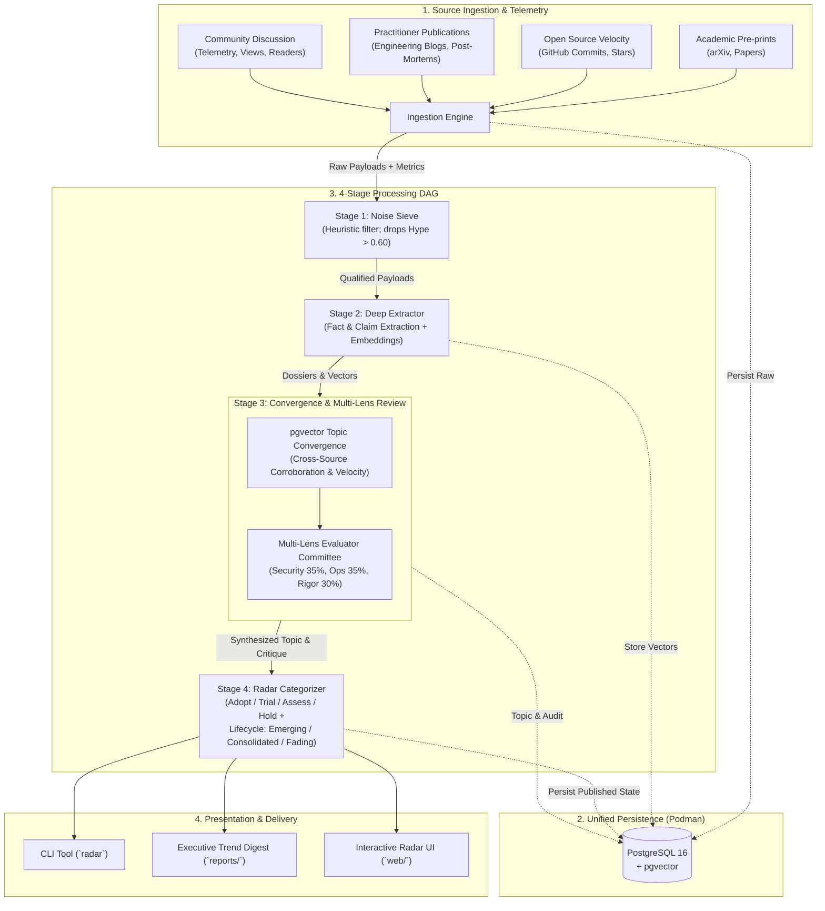

# Trend Horizon Radar

[](https://github.com/cdr74/trend_research/actions/workflows/ci.yml)
[](https://www.python.org/downloads/)
[](https://github.com/astral-sh/ruff)
[](https://mypy-lang.org/)
[](LICENSE)

An autonomous intelligence platform for professionals that continuously monitors, filters, corroborates, and evaluates emerging technology trends in times of rapid disruption.

The platform cuts through vendor marketing, unverified benchmarks, and superficial wrapper tools by enforcing **algorithmic anti-hype penalties**, **cross-source topic corroboration**, **engagement velocity tracking**, and **multi-lens adversarial evaluation**.

---

## 🎯 Core Capabilities

- **Zero-Hype Signal Extraction:** Algorithmic penalties for missing empirical datasets, synthetic vanity metrics, and un-augmented wrapper architectures.
- **Dual-Track Signal Isolation:** Explicit separation between **Software Testing** (deterministic systems) and **AI Evaluation** (non-deterministic systems), linked by agentic SDLC governance.
- **Evidence of Adequacy & Confidence Scoring:** Prioritizes mutation testing, property-based invariants, change-risk impact analysis, and calibrated confidence scores for the accountable human-in-the-loop.
- **Financial Enterprise Guardrails:** Strict penalties for testing in production on live systems, autonomous un-audited merges, and unauthorized cloud code egress.
- **Multi-Source Corroboration:** Semantic clustering (`pgvector`) identifies when independent trusted sources (pre-prints, open-source projects, engineering post-mortems) converge on the same core breakthrough, awarding a positive consensus boost.
- **Audience Telemetry & Engagement Velocity:** Ingestion tracking of readers, viewers, citations, and repository stars with time-decayed velocity ($\Delta \text{metric}/\Delta t$) to differentiate real momentum from fading fads.
- **Multi-Lens Evaluator Committee:** Evaluates innovations across specialized lenses:
  1. *Security & Privacy* (data boundaries, zero-egress, secret protection)
  2. *Operational Feasibility* (deterministic reproducibility, execution footprint, integration ergonomics)
  3. *Technical Rigor* (empirical problem-solving vs synthetic benchmarks)
- **Actionable Decision Velocity:** Bi-weekly executive intelligence briefings and an interactive ThoughtWorks-style Tech Radar (Adopt: Established / Trial: Pilot / Assess: Emerging / Hold: Flawed) with multi-criteria filtering.

---

## 🏛️ System Architecture



---

## 🔬 Reference Profile: Software Quality Engineering (6 Pillars)

```
┌────────────────────────────────────────────────────────────────────────┐
│                        SDLC QE HORIZON RADAR                           │
├──────────────────┬──────────────────┬──────────────────────────────────┤
│ 1. Spec & Model  │ 2. Test Synth    │ 3. Execution & Optimization      │
│  - Spec-to-test  │  - E2E / API     │  - Mutation testing              │
│  - Formal verif. │  - Synthetic gen │  - Predictive test selection     │
│  - Edge-case LLM │  - Mocking / TDM │  - Flaky test auto-isolation     │
├──────────────────┼──────────────────┼──────────────────────────────────┤
│ 4. Triage & Fix  │ 5. Agent Systems │ 6. Governance & Evals            │
│  - RCA agents    │  - Browser-use   │  - LLM-as-a-Judge test suites    │
│  - Self-healing  │  - CLI agents    │  - Safety / Prompt regression    │
│  - Auto-PR patch │  - Multi-agent QE│  - Determinism & audit trails    │
└──────────────────┴──────────────────┴──────────────────────────────────┘
```

---

## 🚀 Quickstart

### Prerequisites
- Python 3.12+
- [`uv`](https://docs.astral.sh/uv/) for Python package and environment management
- [Podman](https://podman.io/) (or Docker) for PostgreSQL + pgvector
- Node.js 20+ (for the web visualizer)

### Installation & Local Run

1. **Clone and setup Python virtual environment:**
   ```bash
   git clone https://github.com/cdr74/trend_research.git
   cd trend_research
   uv sync
   ```

2. **Configure environment:**
   ```bash
   cp .env.example .env
   ```

3. **Start PostgreSQL + pgvector via Podman:**
   ```bash
   podman compose up -d
   ```

4. **Run the test suite:**
   ```bash
   uv run pytest
   ```

5. **Execute a pipeline evaluation in offline mock mode:**
   ```bash
   RADAR_LLM_PROVIDER=mock uv run radar evaluate
   ```

6. **Launch interactive web dashboard:**
   ```bash
   cd web
   npm install
   npm run dev
   ```

---

## 📚 Documentation Index

- [Architecture Decision Records (ADRs)](docs/adr/)
  - [ADR 0000: Macro System Architecture & End-to-End Processing Topology](docs/adr/0000-overall-system-architecture.md)
  - [ADR 0001: Tooling and Runtime Environment (Python 3.12, uv, Ruff, Pytest)](docs/adr/0001-tooling-and-runtime-environment.md)
  - [ADR 0002: Persistence Layer with PostgreSQL and pgvector via Podman](docs/adr/0002-persistence-postgresql-pgvector.md)
  - [ADR 0003: Pluggable LLM Provider Adapter Architecture](docs/adr/0003-pluggable-llm-evaluation-engine.md)
  - [ADR 0004: Pipeline DAG and Schema Contracts](docs/adr/0004-pipeline-dag-and-schemas.md)
  - [ADR 0005: Visualization Strategy and Radar User Interface](docs/adr/0005-visualization-and-radar-ui.md)
  - [ADR 0006: Academic Pre-Print Ingestion Collector (arXiv Atom API)](docs/adr/0006-arxiv-pre-print-ingestion-collector.md)
  - [ADR 0007: Open Source Repository & Metrics Collector (GitHub Ingestor)](docs/adr/0007-github-repository-ingestion-collector.md)
  - [ADR 0008: Practitioner Publication & Media Ingestion Collector (RSS / Atom)](docs/adr/0008-practitioner-rss-atom-feed-collector.md)
  - [ADR 0009: Stage 1 Deterministic Heuristic Noise Sieve](docs/adr/0009-stage-1-heuristic-noise-sieve.md)
  - [ADR 0010: Pluggable LLM Adapters with Local Antigravity (agy) CLI Bridge](docs/adr/0010-pluggable-llm-adapters-and-agy-cli-bridge.md)
  - [ADR 0011: Stage 2 Deep Extractor Agent with Schema Validation and Vector Embeddings](docs/adr/0011-stage-2-deep-extractor-agent.md)
  - [ADR 0012: pgvector Topic Convergence, Cross-Source Corroboration, and Wrapper Detection](docs/adr/0012-pgvector-topic-convergence-and-wrapper-detection.md)
  - [ADR 0013: Stage 3 Multi-Lens Adversarial Evaluator Committee](docs/adr/0013-stage-3-multi-lens-adversarial-evaluator.md)
  - [ADR 0014: Stage 4 Radar Categorizer and Lifecycle Trajectory](docs/adr/0014-stage-4-radar-categorizer-and-lifecycle-trajectory.md)
  - [ADR 0015: Golden Benchmark Evaluation Test Suite and Regression Gates](docs/adr/0015-golden-benchmark-evaluation-test-suite.md)
  - [ADR 0016: Executive Markdown Intelligence Digest Generator](docs/adr/0016-executive-markdown-intelligence-digest-generator.md)
  - [ADR 0017: JSON Data Bundle Exporter and Interactive Web Dashboard](docs/adr/0017-json-data-bundle-exporter-and-interactive-web-dashboard.md)
  - [ADR 0018: Automated SemVer Release Tagging and Changelog Automation via Release Please](docs/adr/0018-automated-semver-release-and-changelog-automation.md)
  - [ADR 0019: Incremental Delta Sync and Watermark Tracking for On-Demand WSL Execution](docs/adr/0019-incremental-delta-sync-and-watermark-tracking.md)
  - [ADR 0020: Interactive Database Lifecycle Probing and User Consent Startup](docs/adr/0020-interactive-db-startup-and-container-lifecycle.md)
- [System Design & Architecture Document](docs/design/architecture.md)
- [Product & Engineering Backlog](docs/BACKLOG.md)
- [User Guide & Operations Manual](docs/USER_GUIDE.md)
- [Curated Data Sources Registry](docs/data_sources.md)
- [Agent & Engineering Directives](AGENTS.md)

---

## 🗺️ Roadmap & Milestones

- [x] **Milestone 1: Repository Baseline, Schemas & Tooling Harness**
- [x] **Milestone 2: Multi-Channel Ingestion & Heuristic Noise Sieve**
- [x] **Milestone 3: Topic Convergence, Adversarial Committee & Evaluation Pipeline**
- [ ] **Milestone 4: Presentation, CLI & Decoupled Interactive Web Dashboard**
- [ ] **Milestone 5: Continuous Delivery, Release & Ops Automation**

See [`docs/BACKLOG.md`](docs/BACKLOG.md) for detailed task breakdowns.

---

## 📄 License

Licensed under the Apache License, Version 2.0. See [LICENSE](LICENSE) for details.
