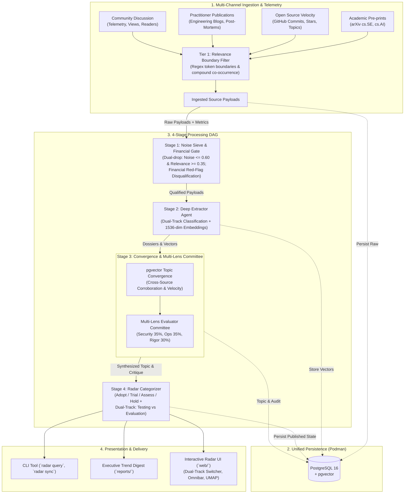

# AI Test Engineering Trend Horizon Radar

[](https://cdr74.github.io/trend_research/)
[](https://github.com/cdr74/trend_research/actions/workflows/ci.yml)
[](https://www.python.org/downloads/)
[](https://github.com/astral-sh/ruff)
[](https://mypy-lang.org/)
[](LICENSE)

An autonomous intelligence platform designed for Quality Engineering (QE) leaders and test engineers operating in highly regulated, high-assurance environments. The platform continuously ingests, filters, corroborates, and evaluates emerging software testing and AI evaluation techniques, cutting through promotional hype, non-reproducible benchmarks, and superficial wrappers with mathematical rigor and auditability.

> [!TIP]
> **Live Zero-Install Radar Dashboard:** Explore the live interactive radar directly in your browser at **[https://cdr74.github.io/trend_research/](https://cdr74.github.io/trend_research/)**.
> Self-contained offline web bundles (`radar-web-dashboard.zip` and `.tar.gz`) are automatically packaged and attached to each **[GitHub Release](https://github.com/cdr74/trend_research/releases)**.

---

## 🎯 Executive Intent & Purpose

Designed for high-assurance, heavily regulated enterprise environments (governed across standards such as FINMA, MAS, PRA, Fed, DORA, and BCBS 239), the platform addresses three core mandates:

1. **AI-Augmented Traditional Software Testing:** How to leverage AI to test deterministic, traditional codebases faster and better (test synthesis, invariant generation, mutation-guided fuzzing, predictive test selection, and sandboxed self-healing).
2. **AI Quality Engineering & Evaluation:** What quality engineering means when the system under test is probabilistic and non-deterministic (LLM evaluation harnesses, autonomous agent trajectory validation, behavioral drift, hallucination detection, and statistical confidence bounds).
3. **Agentic SDLC Governance & Proof of Adequacy:** How to embed testing into native agentic development pipelines without introducing unmanaged operational risk, providing mathematical evidence of test adequacy (mutation scores, formal invariants) and calibrated confidence scores for the accountable human-in-the-loop.

---

## 🛤️ The Dual-Track Architecture

Testing traditional codebases and evaluating non-deterministic AI systems require fundamentally distinct mathematical frameworks, tooling ecosystems, and failure models. The platform enforces an explicit **Dual-Track taxonomy**:

```
┌────────────────────────────────────────────────────────────────────────────────────────┐
│                      AI TEST ENGINEERING HORIZON RADAR TAXONOMY                        │
├───────────────────────────────────────────┬────────────────────────────────────────────┤
│ TRACK 1: SOFTWARE TESTING                 │ TRACK 2: AI EVALUATION                     │
│ (Deterministic Codebases)                 │ (Non-Deterministic / Probabilistic Systems)│
├───────────────────────────────────────────┼────────────────────────────────────────────┤
│ • Automated Test Synthesis (Unit/API/E2E) │ • LLM Benchmark Harnesses & Evals          │
│ • Property-Based Invariant Discovery      │ • Autonomous Agent Trajectory Validation   │
│ • Mutation Testing (PIT, Stryker, mutmut) │ • Adversarial Red-Teaming & Jailbreak Test │
│ • Predictive Test Selection (PTS)         │ • Behavioral Drift & Hallucination Scoring │
│ • Flaky Test Root-Cause Sandboxing        │ • Prompt Regression & Behavioral Envelopes │
│ • Impact-Based Blast-Radius Measurement   │ • Statistical Confidence & LLM-as-a-Judge  │
├───────────────────────────────────────────┴────────────────────────────────────────────┤
│ CROSS-CUTTING: AGENTIC SDLC GOVERNANCE & EVIDENCE OF ADEQUACY                          │
│ • Calibrated Confidence Scoring for Accountable Human-in-the-Loop                      │
│ • Verifiable Proof of Adequacy (Mutation Scores, Invariant Verification, Code-Diff UI) │
│ • Regulatory Audit Trails with Cryptographic Lineage & Retention Proof                 │
│ • Financial Enterprise Red-Flag Disqualification (Zero Testing in Production on Live)  │
└────────────────────────────────────────────────────────────────────────────────────────┘
```

### Track 1: Software Testing (Deterministic Systems)
- **Problem Space:** Traditional software where a given input must produce an exact, reproducible output.
- **Focus:** Leveraging AI to accelerate and sharpen traditional test engineering: invariant generation, property-based test expansion (Hypothesis, QuickCheck), stateful model-based testing, mutation testing to kill surviving mutants, and automated flaky test quarantine.
- **Success Standard:** Verifiable code coverage, high mutation kill ratio, and deterministic regression prevention.

### Track 2: AI Evaluation (Non-Deterministic Systems)
- **Problem Space:** Systems governed by probabilistic model outputs, emergent agent reasoning, and multi-turn tool calling where identical inputs may generate divergent valid paths.
- **Focus:** Evaluation methodologies: LLM-as-a-judge calibration, behavioral drift detection across model updates, prompt regression testing, adversarial safety red-teaming, and statistical confidence interval bounding.
- **Success Standard:** Quantified safety envelopes, statistical drift bounds, and reproducible benchmarking datasets.

### Cross-Cutting: Agentic SDLC Governance & Evidence of Adequacy
- **The Core Risk:** In an agentic SDLC where machines synthesize both code and tests, self-generated tests create a dangerous confirmation-bias blindspot.
- **The Antidote:** Independent mathematical evidence of adequacy. The radar tracks and prioritizes tools that generate objective proofs (e.g. mutation killing scores, formal invariant verification, and blast-radius quantification) to deliver a clear, auditable confidence score to the accountable human engineer before code reaches staging or production.

### Financial Enterprise Guardrails & Red Flags
Candidate technologies are disqualified or assigned to **Hold** if they violate fundamental financial quality principles:
- **Testing in Production on Active Ledgers:** Uncontrolled chaos injection on live transaction systems is strictly prohibited.
- **Autonomous Merge Without Human Oversight:** Bypassing accountable human approval for synthesized code or tests is an instant disqualifier.
- **Unbounded Cloud Code Egress:** Solutions requiring proprietary enterprise code or financial transaction payloads to egress to un-audited third-party clouds are blocked.

---

## 🏛️ System Architecture & 3-Tier Defense-in-Depth

The platform runs a local-first, decoupled architecture backed by **PostgreSQL 16 + pgvector** and a 3-tier defense-in-depth filtering DAG:



### The 4-Stage Processing Pipeline
1. **Tier 1 & Stage 1: Noise Sieve & Relevance Gate:**
   - Drops incoming noise before any LLM invocations using strict token boundaries (`\b`), compound domain co-occurrence, and financial red-flag filters.
   - Dual-Drop Threshold: Noise Score ≤ 0.60 and Domain Relevance Score ≥ 0.35.
2. **Stage 2: Deep Extractor Agent:**
   - Extracts canonical technology names, primary QE pillars, verifiable technical claims, evidence tiers, and Dual-Track classification.
   - Generates dense 1536-dimensional semantic embeddings for vector search.
3. **Stage 3: Topic Convergence & Multi-Lens Committee:**
   - **Cross-Source Corroboration:** Semantic clustering (`pgvector` cosine similarity) identifies when independent sources (arXiv papers, GitHub repos, engineering post-mortems) converge on the same algorithmic pattern, awarding a consensus boost.
   - **Adversarial Audit Committee:** Evaluates signals across three weighted lenses:
     - *Security & Privacy (35%):* Data egress, secret management, on-prem execution.
     - *Operational Feasibility (35%):* CI footprint, determinism, maintenance overhead.
     - *Technical Rigor (30%):* Empirical benchmarks vs synthetic marketing.
4. **Stage 4: Radar Categorizer & Decision Rings:**
   - **Adopt (Industry Standard):** High viability (≥ 0.80), low hype (≤ 0.30), proven artifact backing, and strictly consolidated production track record ($N \ge 3$ or stars ≥ 500). *Mandatory implementation review.*
   - **Trial (High-Confidence Pilot):** High viability (≥ 0.70), low-to-moderate hype (≤ 0.40) including promising emerging innovations. *Approved for sandboxed pilot evaluation.*
   - **Assess (Emerging / Exploratory):** Viability ≥ 0.45 or high engagement velocity (≥ 25.0). *Track for 6–18 month horizon; too early for production.*
   - **Hold (Prohibited / Flawed):** Viability < 0.45, excessive hype (> 0.60), superficial wrappers, or financial red flags.

---

## ⚡ Quickstart & Usage

### Prerequisites
- **Python 3.12+** managed via [`uv`](https://astral.sh/uv)
- **Podman** (or Docker) for PostgreSQL 16 + pgvector
- **Node.js 20+** & npm (for the web visualizer)

### 1. Installation & Environment Setup
```bash
git clone https://github.com/cdr74/trend_research.git
cd trend_research
uv sync
cp .env.example .env
podman compose up -d
```

### 2. Launch the Interactive Web Dashboard
```bash
uv run radar ui
```
*Automatically validates database connectivity, synchronizes live signals into the web bundle, and launches the Vite dashboard on `http://localhost:5173`.*

**Dashboard Capabilities:**
- **Dual-Track Switcher:** One-click filtering between **All Tracks**, **Software Testing (Deterministic)**, and **AI Evaluation (Non-Deterministic)** with reactive signal counters.
- **4 Analytical Views:** Polar Radar Quadrant, Filterable Matrix Table (with Track column), Scatter Matrix (Viability vs Hype), and Semantic 2D UMAP Cluster Map.
- **Search Omnibar:** Instant client-side search supporting structured tokens (`track:testing`, `track:evaluation`, `ring:Adopt`, `viability:>0.8`).

### 3. CLI Intelligence Queries
```bash
# Query only deterministic software testing signals
uv run radar query "track:testing"

# Query only non-deterministic AI evaluation signals
uv run radar query "track:evaluation"

# Filter by ring and viability threshold
uv run radar query --ring Adopt --min-viability 0.8
```

### 4. Routine Incremental Delta Sync
```bash
# Delta sync: ingest and evaluate only newly published signals since last watermark
uv run radar sync

# Force complete 365-day re-baseline and open UI
uv run radar sync --days 365 --reset --ui
```

### 5. Hermetic Verification Suite
```bash
# Run 155 unit & integration tests offline in ~18 seconds
uv run pytest -v

# Run strict type checking and linting
uv run mypy src tests
uv run ruff check .
```

---

## 📚 Key Documentation Index

| Document | Purpose |
| :--- | :--- |
| **[User Guide & Operator Manual](docs/USER_GUIDE.md)** | Step-by-step operator workflows, cheatsheet recipes, CLI commands, and troubleshooting FAQ. |
| **[System Design & Architecture](docs/design/architecture.md)** | Detailed component boundaries, schemas, state models, and persistence topology. |
| **[Domain Guardrails & Relevance (ADR-0021)](docs/adr/0021-multi-tiered-domain-relevance-and-topic-filtering.md)** | Architectural specification of high-assurance enterprise intent, Dual-Track taxonomy, and adequacy rubrics. |
| **[Curated Data Sources Registry](docs/data_sources.md)** | Catalog of active arXiv categories, GitHub topic streams, and engineering RSS feeds. |
| **[Product & Engineering Backlog](docs/BACKLOG.md)** | Milestone roadmaps, user stories, and completed delivery tasks. |
| **[Local Tooling & Invariants (AGENTS.md)](AGENTS.md)** | Local development directives, verification standards, and commit invariants. |

### Key Architecture Decision Records (ADRs)
- **[ADR 0025: GitHub Pages Continuous Deployment and Release Distribution Artifacts](docs/adr/0025-github-pages-continuous-deployment-and-release-artifacts.md)**
- **[ADR 0024: Radar View Ergonomics, Deterministic Blip Layout, and Spec & Model Coverage](docs/adr/0024-radar-view-ergonomics-deterministic-blip-layout-and-spec-model-coverage.md)**
- **[ADR 0023: Dynamic Bounded Topic Convergence and Theme Attribution](docs/adr/0023-dynamic-bounded-topic-convergence-and-theme-attribution.md)**
- **[ADR 0022: Multi-Gated Deterministic Radar Categorization and Practitioner Post-Mortem Protection](docs/adr/0022-multi-gated-deterministic-radar-categorization.md)**
- **[ADR 0021: Multi-Tiered Domain Relevance and Topic Filtering with Financial Enterprise Guardrails](docs/adr/0021-multi-tiered-domain-relevance-and-topic-filtering.md)**
- **[ADR 0020: Interactive Database Lifecycle Probing and Container Startup](docs/adr/0020-interactive-db-startup-and-container-lifecycle.md)**
- **[ADR 0019: Incremental Delta Sync and Watermark Tracking for On-Demand WSL Execution](docs/adr/0019-incremental-delta-sync-and-watermark-tracking.md)**
- **[ADR 0017: JSON Data Bundle Exporter and Interactive Web Dashboard](docs/adr/0017-json-data-bundle-exporter-and-interactive-web-dashboard.md)**
- **[ADR 0013: Stage 3 Multi-Lens Adversarial Evaluator Committee](docs/adr/0013-stage-3-multi-lens-adversarial-evaluator.md)**
- **[ADR 0010: Pluggable LLM Adapters with Local Antigravity (agy) CLI Bridge](docs/adr/0010-pluggable-llm-adapters-and-agy-cli-bridge.md)**
- **[ADR 0009: Stage 1 Deterministic Heuristic Noise Sieve](docs/adr/0009-stage-1-heuristic-noise-sieve.md)**
- **[ADR 0000: Macro System Architecture & End-to-End Processing Topology](docs/adr/0000-overall-system-architecture.md)**

---

## 🗺️ Completed Milestones

- [x] **Milestone 1: Repository Baseline, Schemas & Tooling Harness**
- [x] **Milestone 2: Multi-Channel Ingestion & Heuristic Noise Sieve**
- [x] **Milestone 3: Topic Convergence, Adversarial Committee & Evaluation Pipeline**
- [x] **Milestone 4: Presentation, CLI & Decoupled Interactive Web Dashboard**
- [x] **Milestone 5: Continuous Delivery, Release & Ops Automation**
- [x] **Milestone 6: Domain Relevance, Financial Guardrails & Dual-Track Architecture**
- [x] **Milestone 7: Precision Radar Ranking & Gated Categorization**
- [x] **Milestone 8: Dynamic Bounded Topic Convergence & Theme Attribution**
- [x] **Milestone 9: Radar View Ergonomics, Deterministic Blip Layout & Spec-Model Coverage**
- [x] **Milestone 10: GitHub Pages Continuous Deployment & Release Distribution Artifacts**

---

## 📄 License

Licensed under the Apache License, Version 2.0. See [LICENSE](LICENSE) for details.
