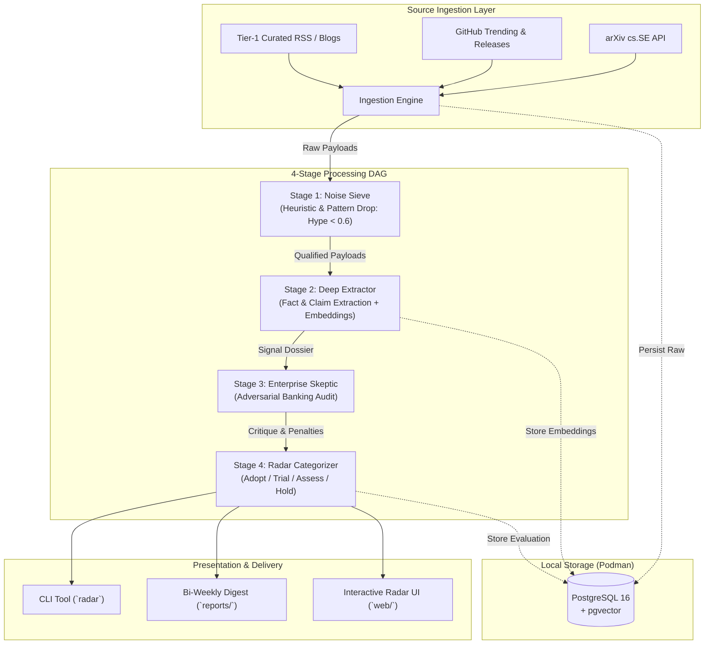

# AI Test Engineering Horizon Radar

[](https://github.com/cdr74/trend_research/actions/workflows/ci.yml)
[](https://www.python.org/downloads/)
[](https://github.com/astral-sh/ruff)
[](https://mypy-lang.org/)
[](LICENSE)

An autonomous intelligence engine that continuously monitors, filters, evaluates, and clusters software development life cycle (SDLC) and Quality Engineering (QE) innovations.

Engineered specifically for high-governance enterprise environments (e.g., Tier-1 investment banking and regulated industries), the Radar cuts through marketing claims, unverified benchmarks, and superficial wrappers by applying **algorithmic anti-hype penalties** and **adversarial banking viability scoring**.

---

## 🎯 Key Objectives & Outgrowths

- **Zero-Hype Signal Isolation:** Algorithmic penalties for missing datasets, synthetic benchmarks, and wrapper architectures.
- **Enterprise-First Vetting:** Rigorous evaluation against 4 mandatory banking gates:
  1. *Deployment Topology* (zero-egress VPC, self-hosted, air-gapped container)
  2. *Deterministic Reproducibility* (seeded execution, zero flakiness in CI/CD)
  3. *Data Security & Privacy* (no proprietary code or schema leaks to third-party endpoints)
  4. *Auditability & Traceability* (machine- and human-auditable reasoning traces)
- **Actionable Decision Velocity:** Bi-weekly executive intelligence briefings and a dynamic, interactive ThoughtWorks-style Tech Radar (Adopt / Trial / Assess / Hold).
- **Flexible Multi-View Exploration:** Interactive web dashboard supporting Quad-Quadrant Radar, Filterable Matrix Grid, Scatter Matrix (Hype vs. Viability), and Semantic Similarity Clustering via vector embeddings.

---

## 🏛️ System Architecture

The Radar operates as a directed acyclic pipeline (DAG) with four decoupled processing stages:



---

## 🔬 Domain Scope: 6 QE Pillars

```
┌────────────────────────────────────────────────────────────────────────┐
│                        SDLC QE HORIZON RADAR                           │
├──────────────────┬──────────────────┬──────────────────────────────────┤
│ 1. Spec & Model  │ 2. Test Synth    │ 3. Execution & Optimization      │
│  - Spec-to-test  │  - E2E / API     │  - Mutation testing              │
│  - Formal verif. │  - Synthetic gen │  - Predictive test selection     │
│  - Edge-case LLM │  - Mocking / TDM │  - Flaky test auto-isolation     │
├──────────────────┼──────────────────┼──────────────────────────────────┤
│ 4. Triage & Fix  │ 5. Agent Systems │ 6. Governance & Evals            │
│  - RCA agents    │  - Browser-use   │  - LLM-as-a-Judge test suites    │
│  - Self-healing  │  - CLI agents    │  - Safety / Prompt regression    │
│  - Auto-PR patch │  - Multi-agent QE│  - Determinism & audit trails    │
└──────────────────┴──────────────────┴──────────────────────────────────┘
```

---

## 🚀 Quickstart

### Prerequisites
- Python 3.12+
- [`uv`](https://docs.astral.sh/uv/) for Python package and environment management
- [Podman](https://podman.io/) (or Docker) for PostgreSQL + pgvector
- Node.js 20+ (for the web visualizer)

### Installation & Local Run

1. **Clone and setup Python virtual environment:**
   ```bash
   git clone https://github.com/cdr74/trend_research.git
   cd trend_research
   uv sync
   ```

2. **Configure environment:**
   ```bash
   cp .env.example .env
   ```

3. **Start PostgreSQL + pgvector via Podman:**
   ```bash
   podman compose up -d
   ```

4. **Run the test suite:**
   ```bash
   uv run pytest
   ```

5. **Execute a pipeline evaluation in offline mock mode:**
   ```bash
   RADAR_LLM_PROVIDER=mock uv run radar evaluate
   ```

6. **Launch interactive web dashboard:**
   ```bash
   cd web
   npm install
   npm run dev
   ```

---

## 📚 Documentation Index

- [Architecture Decision Records (ADRs)](docs/adr/)
  - [ADR 0001: Tooling and Runtime Environment (Python 3.12, uv, Ruff, Pytest)](docs/adr/0001-tooling-and-runtime-environment.md)
  - [ADR 0002: Persistence Layer with PostgreSQL and pgvector via Podman](docs/adr/0002-persistence-postgresql-pgvector.md)
  - [ADR 0003: Pluggable LLM Provider Adapter Architecture](docs/adr/0003-pluggable-llm-evaluation-engine.md)
  - [ADR 0004: Pipeline DAG and Schema Contracts](docs/adr/0004-pipeline-dag-and-schemas.md)
  - [ADR 0005: Visualization Strategy and Radar User Interface](docs/adr/0005-visualization-and-radar-ui.md)
- [System Design & Architecture Document](docs/design/architecture.md)
- [Product & Engineering Backlog](docs/BACKLOG.md)
- [User Guide & Operations Manual](docs/USER_GUIDE.md)
- [Agent & Engineering Directives](AGENTS.md)

---

## 🗺️ Roadmap & Milestones

- [x] **Milestone 1: Repository Baseline, Schemas & Tooling Harness**
- [ ] **Milestone 2: Source Ingestion & Heuristic Noise Sieve**
- [ ] **Milestone 3: Adversarial LLM Multi-Agent Evaluation Pipeline**
- [ ] **Milestone 4: Presentation, CLI & Decoupled Interactive Web Dashboard**
- [ ] **Milestone 5: Continuous Delivery, Release & Ops Automation**

See [`docs/BACKLOG.md`](docs/BACKLOG.md) for detailed task breakdowns.

---

## 📄 License

Licensed under the Apache License, Version 2.0. See [LICENSE](LICENSE) for details.
