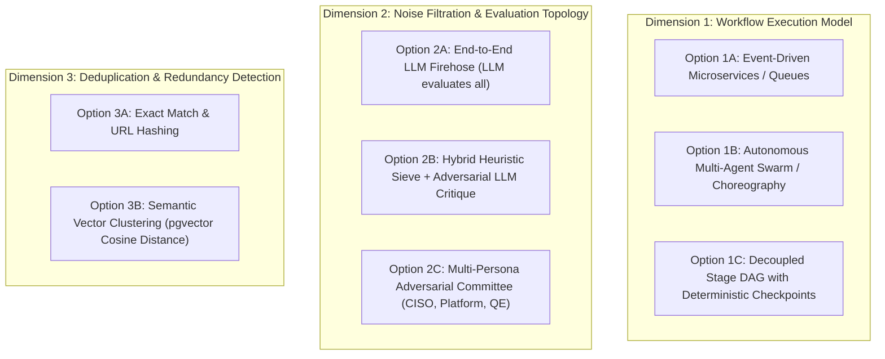
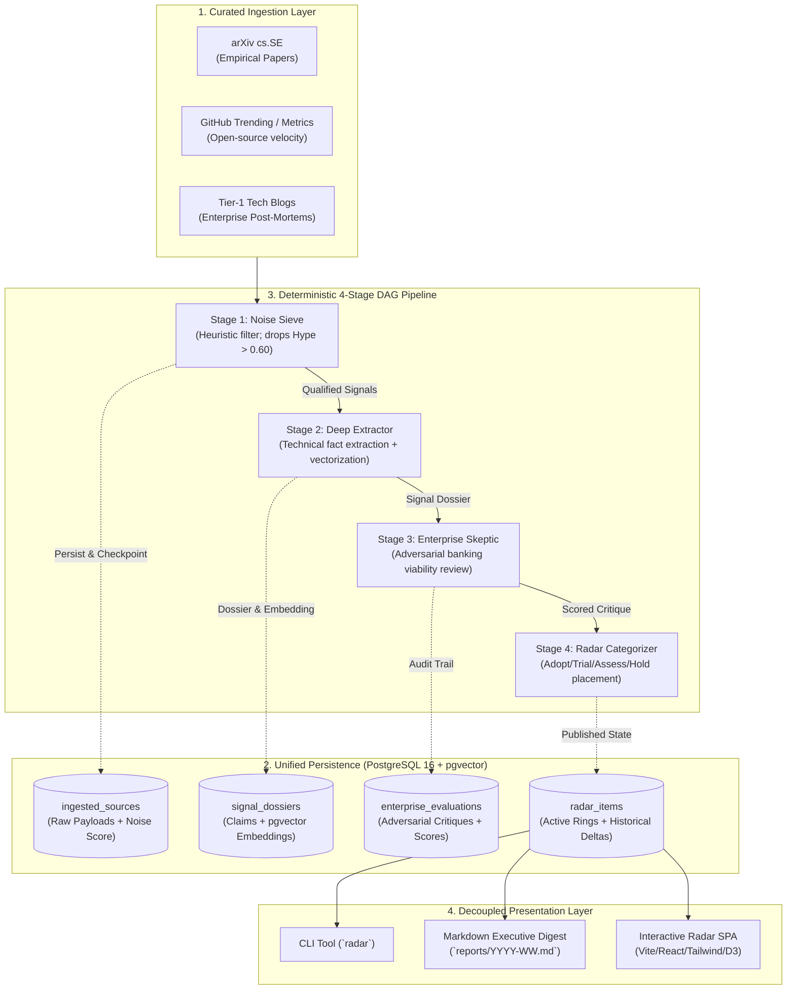

# ADR 0000: Macro System Architecture & End-to-End Processing Topology

## Status
Proposed (Under Active Deliberation)

---

## 1. Context & Problem Statement

### 1.1 Enterprise Background & The Hype Inundation
In the wake of rapid proliferation of generative AI and agentic software development life cycle (SDLC) tooling, engineering leadership—particularly in high-governance, regulated financial institutions (e.g., Tier-1 investment banks, wealth management, payment networks)—is inundated with:
- Aggressive vendor marketing and PR announcements.
- Ephemeral wrappers around commodity proprietary models with minimal domain engineering.
- Unverified, synthetic, or non-reproducible academic and corporate benchmarks (e.g., "99% automated bug fixing" measured on trivial synthetic codebases).
- Affiliate-driven influencer listicles lacking empirical validation.

In a banking environment, the cost of evaluating non-viable tools or adopting non-deterministic, unauditable solutions is exceptionally high:
1. **Security & IP Leakage:** Shipping proprietary source code, DB schemas, or test fixtures to third-party endpoints violates data boundary policies and bank secrecy regulations.
2. **CI/CD Pipeline Corruption:** Introducing stochastic, non-deterministic flaky test generators into automated deployment gates halts delivery velocities and degrades developer trust.
3. **Engineering Opportunity Cost:** Architect hours spent reviewing and attempting sandbox trials of superficial wrappers detract from core platform modernization.

### 1.2 Mission & Objective
The **AI Test Engineering Horizon Radar** is designed to replace manual, ad-hoc discovery with an autonomous, adversarial intelligence pipeline. It continuously monitors, extracts, adversarially audits, and clusters innovations strictly relevant to Software Quality Engineering (QE) and SDLC verification, producing deterministic viability rankings and an interactive Tech Radar.

---

## 2. Core Architectural Questions & Paradigms Considered

Designing this intelligence system requires making fundamental architectural trade-offs across four macro dimensions:

---

### Dimension 1: Workflow Execution & Pipeline Topology

#### Option 1A: Distributed Event-Driven Microservices (Kafka / Celery / RabbitMQ)
- **Concept:** Every ingestion source emits raw event streams into a distributed message broker; worker pools consume messages and process stages independently.
- **Pros:** Scalable to massive unbounded ingestion firehoses (millions of tweets, blogs, articles); decoupled autoscaling.
- **Cons & Failure Modes:** Extreme operational overhead (requires managing brokers, dead-letter queues, worker coordination, distributed tracing); significant deployment friction for an engineering intelligence tool designed to run locally or on modest scheduled compute. Over-engineered for curated ingestion of ~100–500 high-signal items per month.

#### Option 1B: Autonomous Multi-Agent Swarm / Dynamic Choreography (e.g., AutoGen, CrewAI)
- **Concept:** Dynamic agents interact autonomously in open-ended conversations, debating and assigning tasks to each other dynamically.
- **Pros:** Highly flexible emergent behaviors; agents can self-direct exploratory research.
- **Cons & Failure Modes:** Non-deterministic execution loops; runaway token and monetary costs; difficulty in reproducing exact scoring paths for auditing; risk of circular agent negotiations and deadlocks. Violates the strict enterprise requirement for deterministic repeatability and auditable scoring traces.

#### Option 1C (Proposed): Decoupled 4-Stage Directed Acyclic Graph (DAG) with Deterministic Intermediate Checkpoints
- **Concept:** A discrete 4-stage pipeline where data transitions through strictly typed states:
  $$\text{Raw Ingestion} \xrightarrow{\text{Stage 1: Noise Sieve}} \text{Filtered Signal} \xrightarrow{\text{Stage 2: Deep Extractor}} \text{Dossier} \xrightarrow{\text{Stage 3: Enterprise Skeptic}} \text{Critique} \xrightarrow{\text{Stage 4: Radar Categorizer}} \text{Radar Item}$$
- **Pros:** 
  - Predictable execution path with bounded token spend and finite termination.
  - Every stage can be tested in total isolation using unit tests and recorded fixtures.
  - Every stage boundary is persisted to PostgreSQL, allowing offline resumption, replayability, and point-in-time audits.
  - Can be driven either from a local CLI or scheduled via GitHub Actions / container cron jobs without infrastructure daemons.
- **Cons:** Less dynamic than an open-ended agent swarm; pipeline steps are fixed at design time.

---

### Dimension 2: Noise Filtration & Evaluation Topology

#### Option 2A: Pure LLM Firehose Evaluation
- Ingest everything and pass full texts immediately to a large reasoning model (e.g., Gemini 1.5 Pro / GPT-4o).
- **Failure Mode:** Extremely wasteful in token consumption; processing thousands of marketing blogs and vanity press releases wastes computational budget on low-density noise.

#### Option 2B (Proposed Baseline): Two-Tiered Hybrid (Deterministic Heuristic Sieve + Adversarial LLM Critique)
- **Tier 1 (Stage 1 Sieve):** Fast rule-based scoring (regex, domain reputation, keyword density, lack of code/paper link) computing early $Hype > 0.60$ drops before any LLM API call is made. Drops > 70% of low-density marketing at zero LLM cost.
- **Tier 2 (Stages 2 & 3):** Deep extraction and adversarial review applied only to qualified signals that pass the noise sieve.

#### Option 2C (Under Discussion): Multi-Persona Adversarial Committee
- Rather than a single "Enterprise Skeptic" prompt, Stage 3 executes three focused adversarial evaluators:
  1. **The CISO / Security Gate:** Egress risks, token leaks, secret handling in tests, third-party hosting risks.
  2. **The CI/CD Platform Architect:** Deterministic seed replay, flaky test injection risks, pipeline execution latency, runner requirements.
  3. **The Quality Engineering Director:** Test maintainability, mutation effectiveness, real-world defect detection capability vs synthetic vanity pass-rates.
- **Trade-off:** Triples Stage 3 LLM calls, but provides deeply differentiated, multi-perspective banking scrutiny.

---

### Dimension 3: Semantic Deduplication & Redundancy Clustering

#### Option 3A: URL & Metadata Hash Matching Only
- Detects exact reposts of the same link, but completely blind to the rampant phenomenon of "wrapper proliferation" (different vendors marketing the exact same generic prompt pattern or open-source wrapper under new brand names).

#### Option 3B (Proposed): Integrated Relational + Vector Persistence (`pgvector`)
- Ingested technical dossiers generate dense vector embeddings (1536 dims).
- When a new tool or paper is evaluated, the system executes an automated cosine distance query against historical dossiers:
  $$\text{Cosine Distance}(\vec{u}, \vec{v}) = 1 - \frac{\vec{u} \cdot \vec{v}}{\|\vec{u}\| \|\vec{v}\|}$$
- If a candidate signal has semantic similarity $> 0.88$ with an existing entry but provides no new architectural innovation or reproducible baseline, an automatic **Wrapper Penalty ($-0.20$)** is applied.

---

## 3. Decision Rationale & Proposed Architecture

We propose the **Decoupled 4-Stage DAG Architecture** with **Hybrid Heuristic-Adversarial Evaluation** and **Unified PostgreSQL + pgvector Persistence**:

---

## 4. Key Architectural Guarantees & Constraints

1. **Air-Gapped & Zero-Egress Compatibility:**
   The entire system must run with local LLM providers (Ollama / vLLM running Llama 3 / Mistral) and local containerized PostgreSQL (`podman compose up -d`), requiring zero internet egress for corporate/private evaluation batches.
2. **Deterministic Anti-Hype Deductions:**
   All scoring deductions (no dataset $-0.30$, synthetic-only $-0.25$, superficial wrapper $-0.20$, sponsored promo $-0.15$) and engineering bonuses (peer-reviewed $+0.30$, OSS velocity $+0.25$, enterprise case study $+0.20$) are mathematically computed and locked into an immutable audit trail.
3. **Decoupled Visualization:**
   The presentation layer (`web/`) is completely decoupled from the data pipeline, consuming static, versioned `radar.json` snapshots. This allows zero-cost, zero-maintenance hosting via GitHub Pages or enterprise internal static document servers.

---

## 5. Consequences & Trade-offs

### Positive Consequences
- **Predictable Compute & Bounded Cost:** Strict stage gating drops noisy payloads before any LLM invocations occur.
- **Auditability:** Every radar item links back to its exact raw source payload, deep extraction dossier, adversary critique, and vector similarity neighbors.
- **CI Parity & Testability:** The entire pipeline can execute end-to-end in mock mode without network access or LLM API keys during CI.

### Negative Consequences / Trade-offs
- Requires local Podman/PostgreSQL runtime for full stateful persistence.
- Curated ingestion boundaries mean sources must be explicitly maintained rather than crawling the open web indiscriminately.

---

## 6. Open Deliberation Points for the Design Session

Before locking this architecture into full implementation, we invite discussion on the following structural choices:

1. **Enterprise Skeptic Composition (Single vs. Multi-Persona):**
   - *Option A:* Single monolithic "Tier-1 Bank Chief Architect" prompt evaluating topology, determinism, privacy, and auditability in one pass.
   - *Option B:* Three decoupled critic personas (Security/CISO, Platform/CI-CD Architect, QE Practitioner) whose individual scores are weighted and aggregated.
2. **Scope Boundaries for Quality Engineering:**
   - How aggressively should we exclude adjacent SDLC tools? (e.g., General code autocomplete vs. dedicated test synthesis; general log analyzers vs. test failure root-cause analysis).
3. **Historical Trend Tracking & Ring Movements:**
   - How should we capture tool movements over time (e.g., from *Assess* $\rightarrow$ *Trial* $\rightarrow$ *Adopt* or demotion to *Hold*)? Should rings be evaluated dynamically with change-vectors (e.g., $\Delta \text{score}$) recorded per bi-weekly release?
4. **Interactive Dashboard View Modes:**
   - Beyond the 4-quadrant radar and filterable data grid, what additional analytical perspectives are most valuable for leadership reviews? (e.g., Scatter matrix of Hype vs. Viability, Semantic Cluster map of overlapping tools, Timeline/Trend view).
