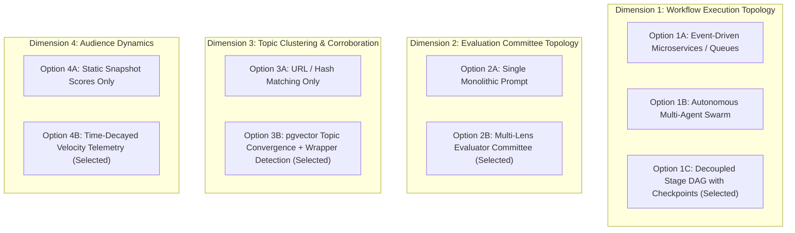
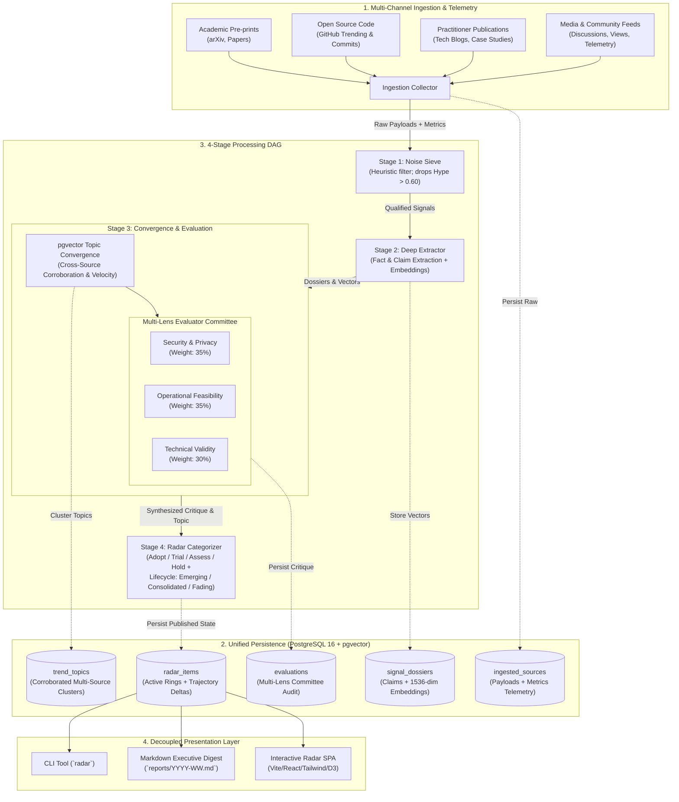

# ADR 0000: Macro System Architecture & End-to-End Processing Topology

## Status
Accepted (Deliberated and locked with Engineering)

---

## 1. Context & Problem Statement

### 1.1 The Information Tsunami & The Professional Dilemma
In eras of rapid technological transition, professionals, researchers, and technical leaders face an overwhelming volume of information:
- Rapid firehose of pre-prints, patents, releases, and announcements.
- Aggressive commercial marketing and PR claims exaggerating capabilities.
- Superficial "wrapper" projects repackaging baseline models with negligible domain innovation.
- Affiliate-driven influencer content, SEO listicles, and non-reproducible benchmarks.

Professionals need to filter **relevant signal from noise** to make informed, defensible adoption decisions. Passive browsing and ad-hoc bookmarking fail at scale; manual vetting is prohibitively expensive.

### 1.2 Mission: Autonomous Horizon Intelligence Platform
The **Trend Horizon Radar** is an autonomous intelligence platform that continuously ingests, filters, extracts, corroborates, and evaluates emerging trends. 

While initially deployed with a reference profile focused on **Software Quality Engineering (QE) and SDLC Innovation**, the platform is architected as a **domain-agnostic trend research capability**. Any professional domain (e.g., Cloud Platforms, AI Security, FinTech, Developer Tooling) can be plugged in by defining a **Domain Profile**.

### 1.3 Key Architectural Pillars
1. **Domain Generality with Pluggable Profiles:** The core engine is generic. Domain taxonomy, noise keywords, and evaluation criteria are defined in modular profiles.
2. **Deterministic Anti-Hype Penalties:** Algorithmic deductions for unverified claims, missing datasets, and superficial wrapper architectures.
3. **Multi-Source Corroboration & Topic Convergence:** Treating independent reporting across distinct trusted channels as a strong positive momentum signal rather than mere duplicate noise.
4. **Audience Traction & Engagement Velocity:** Incorporating audience metrics (stars, citations, views, discussions) with time-decay to distinguish accelerating trends from fading fads.
5. **Multi-Lens Adversarial Evaluation:** Specialized committee personas reviewing innovations against operational feasibility, security/privacy, and empirical validity.
6. **Decoupled Interactive Delivery:** Exportable versioned datasets driving an interactive web visualizer and executive briefs.

---

## 2. Core Architectural Dimensions & Options Considered



---

### Dimension 1: Workflow Execution Model

- **Option 1A (Event-Driven Microservices / Queues):** Scalable to millions of records, but massive operational complexity (brokers, queues, worker coordination) unsuitable for local developer workflows or lightweight scheduled runs.
- **Option 1B (Autonomous Agent Swarms):** Emergent, open-ended dialogues; prone to non-deterministic loops, runaway token spend, and unrepeatable scoring paths.
- **Option 1C (Decoupled Stage DAG with Checkpoints - Selected):** Data transitions through discrete, strongly typed stage boundaries:
  $$\text{Raw Ingestion} \xrightarrow{\text{Stage 1: Noise Sieve}} \text{Filtered Signal} \xrightarrow{\text{Stage 2: Extractor}} \text{Dossier} \xrightarrow{\text{Stage 3: Corroboration}} \text{Topic Cluster} \xrightarrow{\text{Stage 4: Committee}} \text{Radar Item}$$
  *Rationale:* Finite execution, bounded API spend, full auditability, and each stage is independently testable with offline fixtures.

---

### Dimension 2: Evaluation Committee Strategy (Multi-Lens Review)

- **Option 2A (Single Monolithic Prompt):** A single LLM pass attempting to judge technical merits, risks, security, and deployment economics all at once. Tends to average out critical vulnerabilities.
- **Option 2B (Multi-Lens Evaluator Committee - Selected):** Distinct evaluators assess signals through specialized domain lenses:
  1. **Security & Data Privacy Lens (Weight: 35%):** Egress boundaries, credential safety, zero-trust / on-premise execution.
  2. **Operational Feasibility & Determinism Lens (Weight: 35%):** Replayability, infrastructure footprint, integration ergonomics.
  3. **Empirical Technical Validity Lens (Weight: 30%):** Real defect/benchmark results vs synthetic vanity claims, specification rigor.
  $$\text{Composite Viability: } E_v = 0.35 \cdot S_{\text{sec}} + 0.35 \cdot S_{\text{ops}} + 0.30 \cdot S_{\text{tech}}$$

---

### Dimension 3: Topic Convergence & Multi-Source Corroboration

- **Option 3A (URL & Metadata Hash Matching):** Identifies exact link duplicates, but cannot cluster discussions or detect re-packaged wrappers.
- **Option 3B (pgvector Topic Convergence & Wrapper Detection - Selected):**
  Technical embeddings (1536 dims) are indexed using `pgvector`.
  1. **Topic Convergence (Consensus Signal):** If multiple distinct, trusted sources (e.g., an academic paper + an open-source project + an engineering post-mortem) discuss the same core concept ($> 0.82$ cosine similarity), they are synthesized into a **Corroborated Trend Topic**. A positive **Corroboration Multiplier** ($C_{\text{mult}}$) boosts the signal's validity and visibility.
  2. **Parasitic Wrapper Detection:** If a vendor claims a breakthrough but has $> 0.88$ similarity with an existing open-source tool without introducing new architecture or datasets, an automatic **Wrapper Penalty ($-0.20$)** is applied.

---

### Dimension 4: Audience Traction & Engagement Velocity

- **Option 4A (Static Point-in-Time Metrics):** Relying solely on raw star or view counts rewards legacy tools and overlooks accelerating new trends.
- **Option 4B (Time-Decayed Velocity Telemetry - Selected):**
  Sources record available engagement metrics (GitHub stars/forks, reader counts, viewer data, paper citations, discussion volume). The engine tracks metric deltas over time:
  $$\text{Velocity} = \frac{\Delta \text{Engagement}}{\Delta \text{Time}} \times \text{Source Authority}$$
  Signals are assigned a **Lifecycle Trajectory**:
  - `Emerging`: High velocity, low cumulative volume, rising corroboration.
  - `Consolidated`: High volume, steady velocity, proven adoption.
  - `Fading`: Collapsing velocity after an initial viral spike (hype decay).

---

## 3. End-to-End System Architecture



---

## 4. Domain Profile Modularization

The engine decouples general architecture from specific domain rules:

```
src/radar/
├── core/                  # Generic domain models & pipeline engine
├── db/                    # Generic PostgreSQL + pgvector persistence
├── providers/             # Pluggable LLM adapters (Gemini, OpenAI, Ollama, Mock)
├── pipeline/              # Generic DAG stages & clustering
└── profiles/              # Pluggable Domain Profiles
    └── software_quality/  # Reference profile: Quality Engineering & SDLC
        ├── taxonomy.py    # 6 QE Pillars
        ├── heuristics.py  # Anti-hype penalties & bonuses
        └── committee.py   # Specialized CISO, CI/CD, and QE evaluation prompts
```

---

## 5. Consequences & Trade-offs

### Positive Consequences
- **True Generalizability:** The platform can be retargeted to any technical domain by supplying a profile without rewriting pipeline logic.
- **Smarter Noise Filtering:** Distinguishes between empty vendor hype and genuine industry consensus via cross-source corroboration.
- **Temporal Insight:** Audience engagement telemetry and velocity track whether an innovation is gaining ground or losing steam over time.

### Negative Consequences / Trade-offs
- Ingestion connectors must collect and normalize source-specific engagement telemetry (e.g. stars, citations, views).
- Vector clustering introduces a non-trivial similarity query on every ingestion cycle, requiring `pgvector` index tuning (HNSW) as volume scales.
