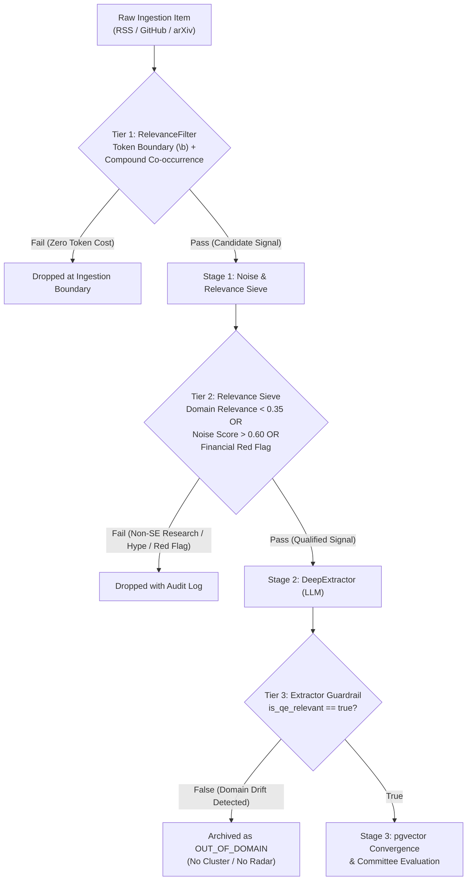

# ADR 0021: Multi-Tiered Domain Relevance and Topic Filtering Architecture

## Status
Accepted

## Context
Milestone 2 introduced automated collectors across academic venues (arXiv), open-source repositories (GitHub), and practitioner blogs (RSS/Atom). In `src/radar/ingestion/rss.py`, feed filtering was initially implemented using a naive lowercase substring match:

```python
def _matches_keywords(text: str, keywords: list[str] | None) -> bool:
    if not keywords:
        return True
    lowered = text.lower()
    return any(k.lower() in lowered for k in keywords)
```

In a tier-1 financial enterprise operating under regulatory oversight (FINMA, MAS, PRA, Fed, DORA, BCBS 239), the radar serves a sharp, dual mission:
1. **Software Testing (Deterministic Systems):** Verifying traditional software (Java, Python, C++, COBOL, microservices) faster with AI (test generation, healing, mutation testing, impact analysis).
2. **AI Evaluation (Non-Deterministic Systems):** Assessing probabilistic systems (LLMs, generative models, autonomous agents) with behavioral drift, benchmark harnesses, and red-teaming.
3. **Cross-Cutting Agentic SDLC & Adequacy Evidence:** Providing calibrated confidence scores to the accountable human-in-the-loop and mathematical evidence of test adequacy (mutation scores, formal invariants) before machine-generated code is deployed.

The previous substring approach produced three critical architectural failure modes:
1. **Token Boundary Blindness (False Positive Inclusions):** Substring checks on short acronyms match arbitrary words (`"ai"` in *email*, *domain*, *fail*; `"ci"` in *incident*, *specific*; `"test"` in *fastest*, *contest*).
2. **Semantic Drift & Polysemy:** Natural language uses "testing" in clinical diagnostics, astrophysics hypotheses, and marketplace sales, which pollute financial software quality engineering.
3. **Absence of Domain Gating in Downstream Pipeline:** High-credibility empirical research outside software engineering (pure mathematics, astronomy) passed Stage 1 with near-zero noise, while Stage 2 lacked an escape hatch, forcing the LLM to hallucinate a fit into quality engineering pillars.

## Requirements & Constraints
1. **Dual-Track Domain Taxonomy:** Explicit separation of **Software Testing** (deterministic systems) and **AI Evaluation** (non-deterministic systems).
2. **Zero Substring Leakage:** Filtering must strictly operate on token boundaries (`\b`) and compound semantic co-occurrences.
3. **Financial Enterprise Guardrails:** Immediate heuristic penalties for practices unacceptable in finance (e.g. testing in production on live systems, autonomous un-audited code merges, cloud code egress).
4. **Evidence of Adequacy Prioritization:** Algorithmic credit for mutation testing, property-based invariants, change-risk impact analysis, and statistical confidence intervals for the human-in-the-loop.
5. **Deterministic Ingestion Pre-Filter:** Tier 1 pre-filtering must execute in memory ($< 1$ms per item) with zero external LLM token spend.
6. **Out-of-Domain Escape Hatch:** Stages 1 & 2 must support safe rejection of out-of-domain signals without pipeline disruption.

---

## Decision Specification: 3-Tier Defense-in-Depth Architecture



### 1. Tier 1: Ingestion Boundary `RelevanceFilter`
Replaces `_matches_keywords` in `src/radar/ingestion/rss.py`:
- **Boundary Matching:** Regex compilation enforcing word boundaries (`\b[a-zA-Z0-9_\-\./+]+\b`).
- **Dual-Track QE Anchors:** Explicit standalone triggers across Testing and Evaluation:
  - *Testing (Deterministic):* `mutation testing`, `property-based testing`, `differential fuzzing`, `flaky test`, `automated program repair`, `test synthesis`, `predictive test selection`, `test impact analysis`, `concolic execution`, `canary analysis`.
  - *Evaluation (Non-Deterministic):* `llm evals`, `llm-as-a-judge`, `red teaming`, `prompt regression`, `hallucination detection`, `agent benchmarking`, `behavioral drift`.
  - *Adequacy Evidence:* `mutation score`, `evidence of adequacy`, `confidence score`, `proof of testing`.
- **Compound Co-occurrence Rules:** Broad terms (`testing`, `verification`, `benchmarking`, `automation`) must co-occur with software engineering qualifiers (`code`, `software`, `ci/cd`, `pipeline`, `runner`, `unit`, `integration`, `assertion`, `regression`).
- **Negative Exclusions:** Rejects corporate noise (`marketplace`, `pricing plan`, `webinar`, `hiring`, `salary survey`).

### 2. Tier 2: Domain Relevance & Financial Guardrails in `NoiseSieve`
In `src/radar/pipeline/noise_sieve.py`:
- **Financial Red-Flag Rules:**
  - Testing in production: `re.compile(r"\b(testing|chaos)\s+in\s+prod(uction)?\b", re.I)` ($+0.40$ penalty).
  - Autonomous merge without review: `re.compile(r"\b(auto-merge|autonomous merge)\s+without\s+(human|review)\b", re.I)` ($+0.35$ penalty).
- **Adequacy & Confidence Credits:**
  - Mutation testing, formal invariants, change-impact scoring, and calibrated confidence intervals receive substantial credibility credits ($-0.15$ to $-0.25$).
- **Domain Relevance Score:** Calculates `domain_relevance_score` $\in [0.0, 1.0]$.
- **Dual-Drop Threshold:**
  $$\text{Qualified} \iff (\text{NoiseScore} \le 0.60) \land (\text{RelevanceScore} \ge 0.35)$$

### 3. Tier 3: Stage 2 Deep Extractor Dual-Track & Escape Valve
In `src/radar/core/models.py` and `src/radar/pipeline/extractor.py`:
- `TrackType` enum: `TESTING = "testing"`, `EVALUATION = "evaluation"`.
- `ExtractedInnovation`:
  - `track: TrackType`
  - `is_qe_relevant: bool = True`
  - `category: str | None`
- If the LLM determines that an ingested item is out-of-domain, it flags `is_qe_relevant = False` and sets `category = None`.
- The pipeline skips vector embedding, skips Stage 3 convergence, and marks the record as `OUT_OF_DOMAIN` in the audit log.

---

## Consequences

### Positive
- **Aligned with Financial Reality:** Directly targets the core concerns of financial test engineering leadership (FINMA, MAS, PRA, Fed).
- **Zero Substring False Positives:** Acronyms like `"ai"` and `"ci"` no longer match arbitrary vocabulary.
- **Robust Defense Against Domain Creep:** Non-software research from general feeds (Microsoft Research, general arXiv categories) is halted before LLM committee evaluation.
- **Token Efficiency:** Preserves LLM token budget by dropping irrelevant items at Tier 1 and Tier 2.
- **Explainable Traceability:** Every dropped item logs the specific tier and rule responsible for rejection.
