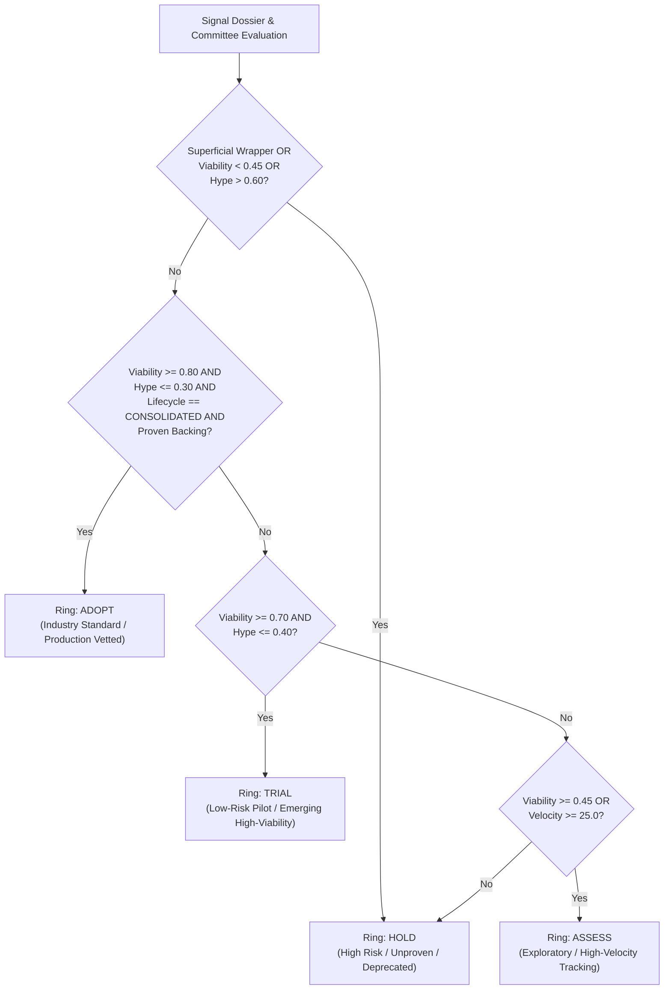

# ADR 0022: Multi-Gated Deterministic Radar Categorization and Ranking

## Status
Accepted (Amends ADR-0014)

## Context
During initial pipeline evaluations of the 23 items on the AI Test Engineering Horizon Radar, an anomalous distribution was detected: 20 items landed in **Adopt**, 3 in **Hold**, and 0 in either **Trial** or **Assess**.

An architectural audit traced this skew to two compounding factors:
1. **Mock Pipeline Clustering & Score Flatness:**
   - In [`MockLLMProvider.generate_structured`](file:///home/chris/dev/trend_research/src/radar/providers/mock.py), numeric float fields defaulted uniformly to `0.75`.
   - In [`MockLLMProvider.embed_text`](file:///home/chris/dev/trend_research/src/radar/providers/mock.py), embedding vectors were computed as `[val] * embedding_dim`. In [`compute_cosine_similarity`](file:///home/chris/dev/trend_research/src/radar/pipeline/convergence.py), two constant non-zero vectors mathematically produce a cosine similarity of `1.0`.
   - This caused all 23 items to collapse into a single topic with `corroboration_count = 23`, awarding an automatic $+0.25$ consensus bonus that suppressed hype scores below $0.25$.
   - In [`TopicConvergenceEngine.converge_dossier`](file:///home/chris/dev/trend_research/src/radar/pipeline/convergence.py), similarity $\ge 0.88$ paired with missing repository links falsely flagged reputable practitioner blog posts (e.g., Netflix engineering post-mortems) as "superficial wrappers", forcing them into **Hold**.
2. **Deficiencies in ADR-0014 Ring Decision Logic:**
   - In ADR-0014, `Adopt` required only `viability >= 0.75` and `hype <= 0.35` with `has_proven_backing`. Because almost every open-source tool possesses a GitHub repository, toy projects and fledgling prototypes (e.g. `checkquest` with 0 velocity, `xhimatty` with 1 velocity) bypassed `Assess` and `Trial` straight into `Adopt`.
   - Ring placement was completely decoupled from `lifecycle_stage`. Even tools classified as `LifecycleStage.EMERGING` were promoted to `Adopt` immediately.
   - In ThoughtWorks Tech Radar semantics, **Adopt** is reserved for production-hardened, battle-tested solutions with high consensus (typically 10–20% of items), while **Trial** and **Assess** should form the vital exploratory core of the radar.

---

## Requirements & Constraints
1. **Lifecycle-Gated `Adopt`:** Promotion to `Adopt` must strictly require `LifecycleStage.CONSOLIDATED` alongside high multi-lens viability ($E_v \ge 0.80$) and low hype ($H \le 0.30$).
2. **Active Middle Tiers (`Trial` & `Assess`):**
   - High-viability candidates ($E_v \ge 0.70$) that are still `LifecycleStage.EMERGING` must route to **Trial** (candidate for enterprise pilot) rather than skipping straight to `Adopt`.
   - Moderate-viability candidates ($E_v \ge 0.45$) or high-velocity emerging techniques ($\text{velocity} \ge 25.0$) must route to **Assess** (worth monitoring and understanding).
3. **Protection of Engineering Post-Mortems:** In Stage 3 topic convergence, `EvidenceTier.ENGINEERING_POST_MORTEM` must never be classified as a parasitic wrapper simply because it lacks a source repository.
4. **Pseudo-Orthogonal Mock Embeddings:** In offline mock testing, embeddings must produce distinct, pseudo-orthogonal vectors to ensure realistic topic clustering and prevent artificial 1.0 cosine similarity collapse.
5. **Deterministic Auditing:** All ring assignment decisions must remain 100% deterministic, reproducible, and configurable via `Settings`.

---

## Decision Specification: Multi-Gated Ring Matrix

### Detailed Decision Gates

| Radar Ring | Minimum Viability ($E_v$) | Maximum Hype ($H$) | Required Lifecycle Stage | Evidence & Corroboration Requisites |
| :--- | :--- | :--- | :--- | :--- |
| **Adopt** | $\ge 0.80$ (`ring_adopt_min_viability`) | $\le 0.30$ (`ring_adopt_max_hype`) | Strictly `CONSOLIDATED` | Verifiable artifact (repo, benchmark, or post-mortem) + corroborated multi-source track record ($N \ge 3$ or stars $\ge 500$) |
| **Trial** | $\ge 0.70$ (`ring_trial_min_viability`) | $\le 0.40$ (`ring_trial_max_hype`) | `EMERGING` or `CONSOLIDATED` | Validated engineering implementation ready for scoped team pilots |
| **Assess** | $\ge 0.45$ (`ring_assess_min_viability`) | $\le 0.60$ | Any | Promising technical claims ($E_v \ge 0.45$) OR high velocity ($\ge 25.0$) warranting enterprise research |
| **Hold** | $< 0.45$ | $> 0.60$ | Any | Flagged as superficial wrapper, excessive hype, or substandard viability |

---

## Consequences

### Positive
- Prevents unvetted, experimental repositories from prematurely entering `Adopt`.
- Populates `Trial` and `Assess` appropriately with high-potential emerging technologies and prototypes.
- Restores ThoughtWorks radar conventions to visual and executive reports.
- Correctly treats engineering post-mortems and retrospectives as high-value practitioner evidence without wrapper penalties.

### Negative / Trade-offs
- Tools with high technical viability ($E_v = 0.85$) cannot enter `Adopt` until they achieve cross-source corroboration ($N \ge 3$) or sustained velocity to reach `CONSOLIDATED` lifecycle status. They will reside in `Trial`, which accurately reflects their pilot status in enterprise settings.
