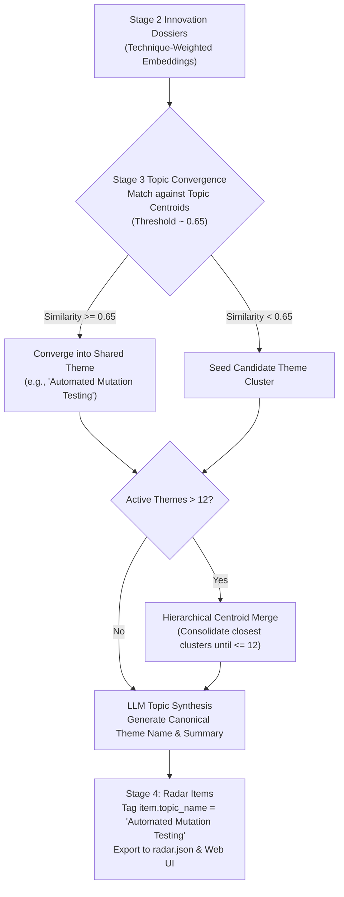

# ADR 0023: Dynamic Bounded Topic Convergence and Theme Attribution

## Status
Proposed (Phase 1 Specification Lock)

## Context
In the current architecture, Stage 3 pgvector Topic Convergence (ADR-0012) clusters technical signals using a greedy 1-Nearest Neighbor (1-NN) approach with a high cosine similarity threshold (`topic_convergence_threshold = 0.82`).

While effective for detecting near-identical parasitic wrappers ($sim \ge 0.88$), this high threshold causes extreme fragmentation when evaluating concrete tools across the ecosystem:
1. **Scattered Thematic Innovations:**
   - 8 distinct mutation testing tools (`pitest`, `stryker-js`, `stryker-net`, `mutant`, `infection`, `mutmut`, `mull`, `AutoMut-ADS`) are scattered across 7+ isolated clusters because differences in language runtime (Java, PHP, C++, .NET) and tool names pull raw text embeddings below $0.82$.
   - The radar ended up with 22 clusters for 23 items, rendering "themes" meaningless.
2. **Missing Theme Attribution on Radar Items:**
   - [`RadarItem`](file:///home/chris/dev/trend_research/src/radar/core/models.py) contains `topic_id: UUID`, but lacks a descriptive `topic_name` (or `theme`).
   - Consequently, topic synthesis is omitted from `radar.json` exports and the Web UI, leaving users with no visual or search mechanism to explore tools by technological theme.

Rather than imposing a rigid, static theme taxonomy or introducing an unneeded meta-layer at this stage, the user has instructed that **themes must remain dynamic, while bounding the total number of synthesized themes below 10 or 12**.

---

## Requirements & Constraints
1. **Dynamic Theme Discovery (No Static Meta-Taxonomy):** Themes must continue to be synthesized autonomously by the LLM from convergent signal clusters.
2. **Bounded Macro View ($K < 10\text{--}12$):** Topic convergence must cluster related ecosystem tools into a cohesive set of themes (targeting 5 to 10 active themes across a typical radar batch).
3. **Technique-Weighted Semantic Embeddings:** In Stage 2 ([`DeepExtractor`](file:///home/chris/dev/trend_research/src/radar/pipeline/extractor.py)), the semantic text passed to `embed_text()` must emphasize the underlying engineering technique and problem domain rather than transient repository names or language-specific boilerplate.
4. **Centroid-Based Bounded Convergence:**
   - Replace greedy 1-NN item matching with topic-centroid matching using a calibrated theme threshold ($\tau_{\text{theme}} \approx 0.65$).
   - If an evaluation batch yields $> 12$ clusters, iteratively merge closest topic centroids until cluster count $\le 12$ (provided similarity $\ge 0.50$).
5. **First-Class Theme Attribution in Presentation:**
   - Add `topic_name: str` to [`RadarItem`](file:///home/chris/dev/trend_research/src/radar/core/models.py).
   - Export `topic_name` in `radar.json`.
   - Surface dynamic theme badges in the Web UI (`TableView`, `ItemDetailModal`, and Omnibar search token `theme:<name>`).

---

## Decision Specification: Dynamic Bounded Topic Engine



### 1. Bounded Topic Clustering Parameters

| Parameter | Current Value | Proposed Value | Architectural Role |
| :--- | :---: | :---: | :--- |
| `RADAR_TOPIC_CONVERGENCE_THRESHOLD` | `0.82` | `0.65` | Semantic threshold for grouping tools under a shared dynamic theme. |
| `RADAR_WRAPPER_SIMILARITY_THRESHOLD` | `0.88` | `0.88` | Unchanged: strictly reserved for parasitic wrapper detection. |
| `RADAR_MAX_DYNAMIC_THEMES` | *None* | `12` | Upper bound on active dynamic theme clusters across an evaluated radar view. |

### 2. Technique-First Embedding Composition ([extractor.py](file:///home/chris/dev/trend_research/src/radar/pipeline/extractor.py))
Adjust `embedding_text` to prioritize the core problem domain and methodology:
```python
embedding_text = (
    f"Domain: {extracted.category.value}. "
    f"Technique: {extracted.key_innovation}. "
    f"Claims: {' '.join(extracted.technical_claims)}. "
    f"Tool: {extracted.name}"
)
```
Placing the technique and claims ahead of the repository name aligns dense embeddings of diverse language tools (Java Pitest, TS Stryker, PHP Infection) within the same semantic subspace.

### 3. Theme Attribution Contract ([models.py](file:///home/chris/dev/trend_research/src/radar/core/models.py))
Extend [`RadarItem`](file:///home/chris/dev/trend_research/src/radar/core/models.py#L270):
```python
class RadarItem(BaseModel):
    ...
    topic_id: UUID | None = None
    topic_name: str | None = (
        None  # Canonical dynamic theme name (e.g. 'Automated Mutation Testing')
    )
```

---

## Consequences

### Positive
- Gathers scattered tools (like the 8 mutation testing frameworks) under a single cohesive dynamic theme.
- Keeps radar themes manageable (< 10–12) without requiring hardcoded static taxonomies or rigid meta-layers.
- Exposes theme attribution to the Web UI, enabling users to filter, sort, and inspect tools by technological movement.

### Negative / Trade-offs
- Setting $\tau_{\text{theme}} = 0.65$ means tools with moderate semantic overlap might occasionally cluster together if an evaluation batch is very sparse. Mitigated by LLM topic re-synthesis and centroid averaging.
