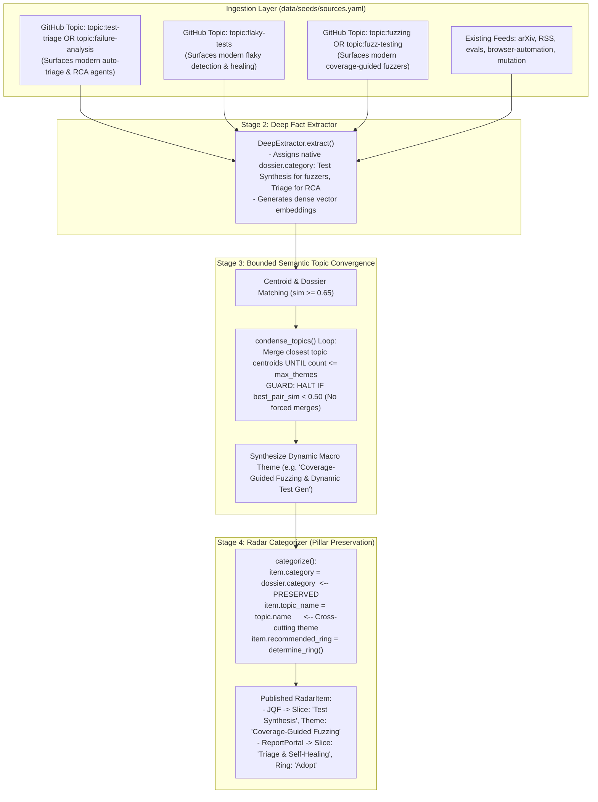

# ADR 0029: Discovery Stream Expansion, Semantic Convergence Floor, and Pillar Integrity Guardrails

## Status
Proposed (Phase 1 Specification Lock - Pending Operator Approval)

## Context
Analysis of the 312 evaluated signals on the Trend Horizon Radar identified two structural anomalies in signal placement and discovery:

1. **Pillar Misalignment & Thematic Bleeding:**
   - [`rohanpadhye/JQF`](file:///home/chris/dev/trend_research/web/public/radar.json) (a coverage-guided semantic fuzzing engine for the Java Virtual Machine) and [`loiclec/fuzzcheck-rs`](https://github.com/loiclec/fuzzcheck-rs) (a structure-aware evolutionary fuzzer for Rust) are displayed under the **Triage & Self-Healing** radar quadrant within the topic *"Automated Failure Diagnosis & Self-Healing"*.
   - Fuzzing is an input synthesis and defect generation technique that canonically belongs to the **Test Synthesis** domain pillar.
   - An architectural audit traced this bleeding to three compounding pipeline defects:
     - **Blind Category Overwrite in Stage 4:** In [`categorizer.py` (line 159)](file:///home/chris/dev/trend_research/src/radar/pipeline/categorizer.py#L159), `category = topic.category if topic else dossier.category`. An individual item's specific domain pillar is forcibly overwritten by the macro topic's synthesized category.
     - **Unbounded Cluster Condensation in Stage 3:** In [`convergence.py`](file:///home/chris/dev/trend_research/src/radar/pipeline/convergence.py#L283-L322), [`condense_topics()`](file:///home/chris/dev/trend_research/src/radar/pipeline/convergence.py#L283-L322) loops `while len(self._topics) > self.max_themes`, merging nearest topic centroids without enforcing the $\text{similarity} \ge 0.50$ floor specified in ADR-0023. Unseeded or low-density topics (like fuzzing tools) are forcibly collapsed into the nearest large cluster regardless of semantic divergence.
     - **Sapienz & Mock Keyword Collision:** In [`MockProvider`](file:///home/chris/dev/trend_research/src/radar/providers/mock.py#L87-L94), Meta's mobile fuzzing research (*"Sapienz Receives ISSTA 2026 Impact Paper Award"*) was matched to `QECategory.TRIAGE_AND_FIX` / *"Automated Failure Diagnosis & Self-Healing"*. Because fuzzing lacked a dedicated thematic embedding seed, fuzzing tools gravitated toward the Sapienz/Pensive cluster.

2. **Discovery Vacuum in `Triage & Self-Healing`:**
   - Established auto-triage capabilities (such as [`reportportal.io`](https://reportportal.io), which pioneered AI/ML-driven test execution failure triage and automated defect categorization) are missing from the radar.
   - Audit of [`data/seeds/sources.yaml`](file:///home/chris/dev/trend_research/data/seeds/sources.yaml) revealed that the GitHub collector runs queries for `test-generation`, `mutation-testing`, `evals`, `browser-automation`, `llm-red-teaming`, and `property-based-testing`.
   - **Zero queries** target `Triage & Self-Healing` (no `topic:test-triage`, `topic:flaky-tests`, or `topic:failure-analysis`) and zero queries target `topic:fuzzing`.
   - Consequently, the only reason "Failure Diagnosis" existed as a topic was a single practitioner blog post from Netflix (*"Making Failure Diagnosis Reliable with Pensive AI"*). That isolated cluster acted as a gravitational sink, swallowing unrelated fuzzing and database health scripts during condensation.

---

## Architectural Principles & Requirements

1. **Horizon Mandate (Anti-Pollution Invariant):**
   - The primary purpose of the Trend Horizon Radar is **spotting new solutions, novel engineering paradigms, and emerging open-source approaches**.
   - The radar must **not** be flooded with dozens of mature legacy frameworks (e.g. JUnit, Selenium, Vitest) merely to fill rings. The baseline must stay clean, focused on forward-looking movements.

2. **Native Pillar Preservation with Cross-Pillar Themes (Option B):**
   - In Stage 4 categorization, an item's functional Quality Engineering domain pillar ([`dossier.category`](file:///home/chris/dev/trend_research/src/radar/core/models.py#L110)) must be strictly preserved on the published [`RadarItem`](file:///home/chris/dev/trend_research/src/radar/core/models.py#L270).
   - Dynamic topics ([`topic_name`](file:///home/chris/dev/trend_research/src/radar/core/models.py#L274)) may span across multiple pillars (e.g., an AI-assisted evaluation theme encompassing both generation and triage), but individual blips must always render in their native functional quadrant slice on the radar chart.

3. **Strict Similarity Floor for Topic Condensation:**
   - In Stage 3 condensation, centroid merging must strictly respect a minimum similarity threshold ($\tau_{\text{merge}} \ge 0.50$, configurable via `settings.topic_merge_min_similarity`).
   - If the most similar remaining topic pair has $\text{similarity} < \tau_{\text{merge}}$, condensation must halt immediately—even if total topic count exceeds `max_themes`. Semantically incompatible engineering concepts must never be forcibly merged.

4. **Expanded Discovery Feeds for Triage and Fuzzing:**
   - In [`data/seeds/sources.yaml`](file:///home/chris/dev/trend_research/data/seeds/sources.yaml), add active GitHub topic discovery streams for `Triage & Self-Healing` and `Test Synthesis` (Fuzzing).
   - This ensures new approaches (e.g., LLM-based root-cause analysis agents, flaky test quarantines, modern fuzzers) surface organically through the continuous ingestion pipeline.

5. **Ad-Hoc High-Authority Exemplar Ingestion:**
   - Operators can inject specific industry reference benchmarks (such as `reportportal/reportportal`) on-demand via the CLI (`radar ingest --url <url>`) with high authority weight, placing them in `Adopt` without hardcoding static fixtures.

---

## Decision Specification: Pipeline Integrity & Discovery Architecture



### 1. Pillar Integrity Contract in Stage 4 ([categorizer.py](file:///home/chris/dev/trend_research/src/radar/pipeline/categorizer.py))
Replace the topic category override:
```python
# Before (ADR-0023):
category = topic.category if topic else dossier.category

# After (ADR-0029 - Option B):
# Retain the extractor's specific QE domain pillar classification.
# The macro topic name provides cross-pillar thematic grouping without mutating quadrant placement.
category = dossier.category
topic_name = topic.name if topic else None
```

### 2. Guardrailed Condensation Floor in Stage 3 ([convergence.py](file:///home/chris/dev/trend_research/src/radar/pipeline/convergence.py))
Update [`TopicConvergenceEngine.condense_topics()`](file:///home/chris/dev/trend_research/src/radar/pipeline/convergence.py#L283):
```python
async def condense_topics(self) -> None:
    """Condense topics if count exceeds max_themes by merging the most similar topic pairs.
    
    Halt immediately if best similarity is below topic_merge_min_similarity (default 0.50).
    """
    while len(self._topics) > self.max_themes:
        topic_ids = list(self._topics.keys())
        best_pair: tuple[UUID, UUID] | None = None
        best_pair_sim = -1.0

        for i in range(len(topic_ids)):
            for j in range(i + 1, len(topic_ids)):
                t1_id, t2_id = topic_ids[i], topic_ids[j]
                d1 = [d for d in self._dossiers.values() if d.topic_id == t1_id]
                d2 = [d for d in self._dossiers.values() if d.topic_id == t2_id]
                c1 = self._compute_centroid(d1)
                c2 = self._compute_centroid(d2)
                sim = compute_cosine_similarity(c1, c2)
                if sim > best_pair_sim:
                    best_pair_sim = sim
                    best_pair = (t1_id, t2_id)

        # Guardrail: Never merge semantically disparate topics below similarity floor
        if best_pair is None or best_pair_sim < self.merge_min_similarity:
            break

        keep_id, merge_id = best_pair
        # ... perform clean centroid merge ...
```

Add configuration parameter in [`Settings`](file:///home/chris/dev/trend_research/src/radar/core/config.py):
```python
topic_merge_min_similarity: float = Field(
    default=0.50,
    ge=0.0,
    le=1.0,
    alias="RADAR_TOPIC_MERGE_MIN_SIMILARITY",
    description="Minimum cosine similarity required to merge topic clusters during Stage 3 condensation",
)
```

### 3. Expanded Ingestion Stream Configuration ([sources.yaml](file:///home/chris/dev/trend_research/data/seeds/sources.yaml))
Add targeted discovery sources for auto-triage, flaky tests, and fuzzing:
```yaml
  - id: "github-topic-test-triage"
    name: "GitHub Topic: Test Triage & Failure Analysis"
    channel: "github"
    endpoint_url: "https://api.github.com/search/repositories"
    authority_weight: 1.15
    enabled: true
    query_params:
      q: "topic:test-triage OR topic:failure-analysis OR topic:root-cause-analysis sort:updated"
    telemetry_fields: ["stars", "forks", "open_issues"]
    description: "Automated root-cause analysis, defect triage, and failure diagnostic tools."

  - id: "github-topic-flaky-tests"
    name: "GitHub Topic: Flaky Tests & Self-Healing"
    channel: "github"
    endpoint_url: "https://api.github.com/search/repositories"
    authority_weight: 1.1
    enabled: true
    query_params:
      q: "topic:flaky-tests OR topic:flaky-test-detection sort:updated"
    telemetry_fields: ["stars", "forks"]
    description: "Flaky test detection, quarantine strategies, and automated repair runners."

  - id: "github-topic-fuzzing"
    name: "GitHub Topic: Fuzzing & Dynamic Program Analysis"
    channel: "github"
    endpoint_url: "https://api.github.com/search/repositories"
    authority_weight: 1.15
    enabled: true
    query_params:
      q: "topic:fuzzing OR topic:fuzz-testing sort:stars"
    telemetry_fields: ["stars", "forks"]
    description: "Coverage-guided fuzzing, grammar-based fuzzing, and invariant exploration engines."
```

### 4. Mock LLM Alignment ([mock.py](file:///home/chris/dev/trend_research/src/radar/providers/mock.py))
- Introduce thematic embedding seed `8080808` for fuzzing keywords (`"fuzz"`, `"fuzzing"`, `"jqf"`, `"fuzzcheck"`, `"zest"`, `"afl"`, `"jazzer"`, `"sapienz"`).
- In `generate_structured(SynthesizedTopic)`:
  - Add `"Coverage-Guided Fuzzing & Dynamic Test Generation"` (`QECategory.TEST_SYNTHESIS`).
  - Add `"Automated Defect Triage & Failure Observability"` (`QECategory.TRIAGE_AND_FIX`).
- In `generate_structured(ExtractedInnovation)`:
  - Ensure fuzzing prompts map to `QECategory.TEST_SYNTHESIS`.
  - Disentangle `Sapienz` from failure diagnosis; classify it under `Test Synthesis`.

---

## Consequences

### Positive
- **Taxonomic Fidelity:** Fuzzing tools (`JQF`, `fuzzcheck-rs`) reside accurately in **Test Synthesis** while failure diagnostics (`Pensive`, `ReportPortal`) reside in **Triage & Self-Healing**.
- **Immunity from Conglomerate Merges:** Enforcing $\tau_{\text{merge}} \ge 0.50$ prevents unrelated engineering disciplines from being forcibly mashed together during topic condensation.
- **Trend-First Discovery:** Opens active ingestion channels for modern AI triage agents and self-healing tools without polluting the radar with legacy tools.
- **Cross-Pillar Flexibility:** Supports cross-cutting macro themes (e.g., an LLM testing theme encompassing both generation and repair) without compromising visual quadrant placement.

### Negative / Trade-offs
- If an evaluation batch contains more than `max_themes` (12) highly diverse, mutually orthogonal innovations with similarity $< 0.50$, the system will preserve $> 12$ topics rather than compressing them.
  - *Mitigation:* This is desirable behavior: maintaining genuine semantic boundaries is far more important than an arbitrary count cap.
