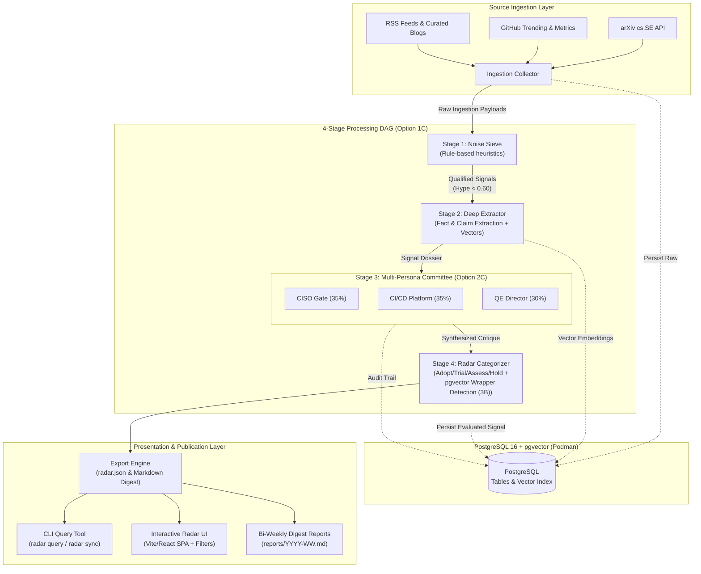
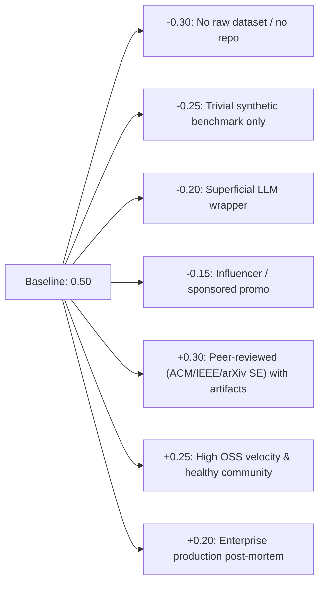
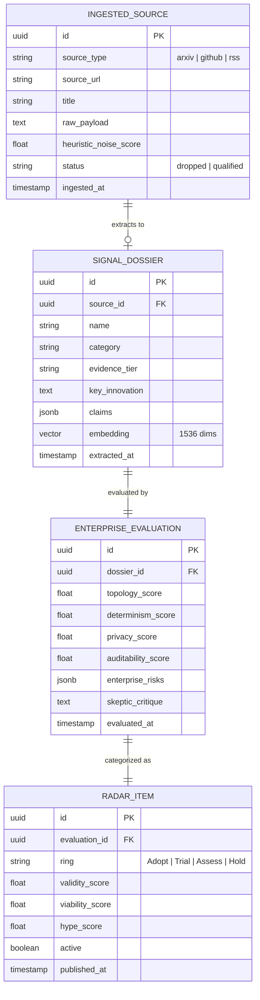

# System Design & Architecture: AI Test Engineering Horizon Radar

## 1. System Overview & Problem Statement

Engineering leadership in high-governance, regulated financial enterprise environments faces an overwhelming wave of AI-generated claims and marketing wrappers surrounding Software Development Life Cycle (SDLC) and Quality Engineering (QE) tools. Adopting non-viable, non-deterministic, or data-leaking tools incurs severe operational and compliance risks.

The **AI Test Engineering Horizon Radar** is an automated, adversarial intelligence pipeline designed to ingest, filter, evaluate, and cluster QE innovations. It filters out marketing noise and scores innovations against banking-grade enterprise viability criteria, publishing structured intelligence briefings and an interactive Tech Radar.

---

## 2. High-Level Architecture & Pipeline DAG

The system is structured as a directed acyclic pipeline (DAG) with clean separation of concerns across ingestion, heuristic filtering, deep extraction, adversarial critique, scoring synthesis, and presentation.



---

## 3. Domain Taxonomy & QE Pillars

All signals are categorized into one of six core SDLC Quality Engineering pillars:

| Pillar | Domain Scope | Example Targets |
| :--- | :--- | :--- |
| **1. Spec & Model** | Requirements-to-test generation, formal verification, model-based testing, edge-case generation. | Spec-driven test gen, property testing LLMs, OpenAPI-to-contract tests. |
| **2. Test Synth** | Automated E2E, integration, and unit test generation, synthetic data synthesis, Test Data Management (TDM), API mocking. | Playwright/Cypress synthesizers, differential unit test generators, privacy-preserving synthetic TDM. |
| **3. Execution & Optimization** | Mutation testing, predictive test selection (PTS), flaky test isolation, test suite minimization, parallel distributed scheduling. | ML-based test prioritization, mutation analysis agents, quarantine controllers. |
| **4. Triage & Fix** | Root Cause Analysis (RCA), self-healing test scripts, automated PR repair patches, regression localization. | Failure log RCA agents, locator auto-healers, automated stack trace analyzers. |
| **5. Agent Systems** | Autonomous browser-use testing agents, CLI-driven coding agents for QE, multi-agent cooperative testing workflows. | Browser-use agents, multi-agent adversarial test discovery, interactive exploratory agents. |
| **6. Governance & Evals** | LLM-as-a-judge test suites, safety, red-teaming, prompt regression, determinism verification, audit logging. | Model evaluation harnesses, guardrail testing, zero-egress compliance checkers. |

---

## 4. Evaluation Rubric & Scoring Engine

Each signal receives two normalized scores in the range `[0.0, 1.0]`:

### 4.1 Signal Validity Score ($S_v$)
Baseline starts at $0.50$ and is adjusted based on verified technical characteristics:



The composite **Hype Score** is defined as $H = 1.0 - S_v$.

### 4.2 Enterprise Viability Score ($E_v$)
The **Adversarial Banking Committee (Option 2C)** evaluates qualified signals across three governance mandates:

1. **CISO / Security Gate (Weight: 35%):** Zero-egress VPC, air-gapped on-prem container compatibility, customer data boundary enforcement, credential scrubbing.
2. **CI/CD Platform Architect (Weight: 35%):** Deterministic reproducibility (seeded execution, zero flakiness), runner resource economics, flaky test quarantine mechanisms.
3. **Quality Engineering Director (Weight: 30%):** True defect discovery vs synthetic vanity metrics, locator resilience, mutation score improvement, contract/spec adherence.

$$\text{Composite Viability: } E_v = 0.35 \cdot S_{\text{security}} + 0.35 \cdot S_{\text{cicd}} + 0.30 \cdot S_{\text{qe}}$$

### 4.3 Radar Ring Assignment Matrix

Based on composite $(S_v, E_v)$:

```
           Viability (Ev)
                ▲
            1.0 ┼──────────────┬──────────────┐
                │    TRIAL     │    ADOPT     │
                │              │              │
                │  Ev >= 0.70  │  Ev >= 0.85  │
                │  Sv >= 0.60  │  Sv >= 0.80  │
            0.5 ┼──────────────┼──────────────┤
                │     HOLD     │    ASSESS    │
                │              │              │
                │  Ev < 0.50   │  Ev >= 0.50  │
                │  or Sv < 0.4 │  Sv >= 0.50  │
            0.0 ┴──────────────┴──────────────► Validity (Sv)
               0.0            0.5            1.0
```

- **Adopt:** High validity, proven enterprise readiness, deterministic, zero-egress capable. Recommended for production pilot.
- **Trial:** High viability and strong promise, worthy of sandboxed project trials to evaluate integration economics.
- **Assess:** High research or technical validity, but early in enterprise maturity or requiring cloud egress mitigations. Keep on watchlist.
- **Hold:** Excessive hype, superficial wrapper architecture, non-deterministic flakiness, or prohibitive data privacy risks. Not recommended.

---

## 5. Component Breakdown & Boundaries

The codebase is organized into modular packages under `src/radar/`:

```
src/radar/
├── core/                  # Core abstractions, configs, and Pydantic schemas
│   ├── config.py          # Settings management (pydantic-settings)
│   ├── models.py          # Domain data models & JSON schema contracts
│   └── exceptions.py      # Domain exceptions
├── db/                    # Persistence layer (PostgreSQL + pgvector)
│   ├── session.py         # Async engine & session lifecycle
│   ├── tables.py          # SQLAlchemy ORM table definitions
│   └── repository.py      # Async repository operations (CRUD & vector similarity)
├── providers/             # Pluggable LLM and embedding adapters
│   ├── base.py            # Abstract Provider interface (Protocol)
│   ├── gemini.py          # Google Gemini provider adapter
│   ├── openai_compat.py   # OpenAI / Ollama / vLLM provider adapter
│   └── mock.py            # Offline deterministic test mock provider
├── ingestion/             # Source ingestion modules
│   ├── base.py            # Base ingestor contract
│   ├── arxiv.py           # arXiv cs.SE paper ingestor
│   ├── github.py          # GitHub repository and release ingestor
│   └── rss.py             # Curated engineering blog and RSS ingestor
├── pipeline/              # 4-stage DAG orchestration
│   ├── stage1_sieve.py    # Rule-based heuristic noise filter
│   ├── stage2_extract.py  # LLM-assisted deep technical extractor
│   ├── stage3_skeptic.py  # LLM adversarial banking skeptic critique
│   ├── stage4_radar.py    # Ring categorizer and scoring synthesizer
│   └── orchestrator.py    # End-to-end DAG runner
└── presentation/          # Output and presentation engines
    ├── cli.py             # CLI entry points (radar sync, query, export)
    ├── export.py          # radar.json serializer & static generator
    └── digest.py          # Bi-weekly Markdown digest reporter
```

---

## 6. Data Models & Schemas

### 6.1 Database Schema (PostgreSQL 16 + pgvector)



---

## 7. Interactive Visualization Architecture

To satisfy user needs for flexible views and dynamic filtering:
1. **Radar JSON Contract (`data/export/radar.json`):**
   Self-contained JSON artifact containing all active radar items, historical scores, tags, risk breakdowns, and 2D UMAP projection coordinates.
2. **Frontend UI (`web/`):**
   - Built with Vite, React, TypeScript, and Tailwind CSS.
   - Decoupled from backend servers; can be deployed directly to GitHub Pages or run locally.
   - **View Switcher:**
     - **Radar View:** Traditional 4-quadrant / 4-ring radar visualization.
     - **Matrix Table:** Searchable table with column sorting and deep dossier expansion.
     - **Scatter Plot View:** Two-axis interactive scatter chart (Hype vs Enterprise Viability).
     - **Cluster View:** Semantic similarity clustering visualizer based on `pgvector` embeddings.
   - **Multi-Filter Sidebar:** Instant client-side filtering by Ring, Pillar, Evidence Tier, Score Thresholds, and Risk Tags.
