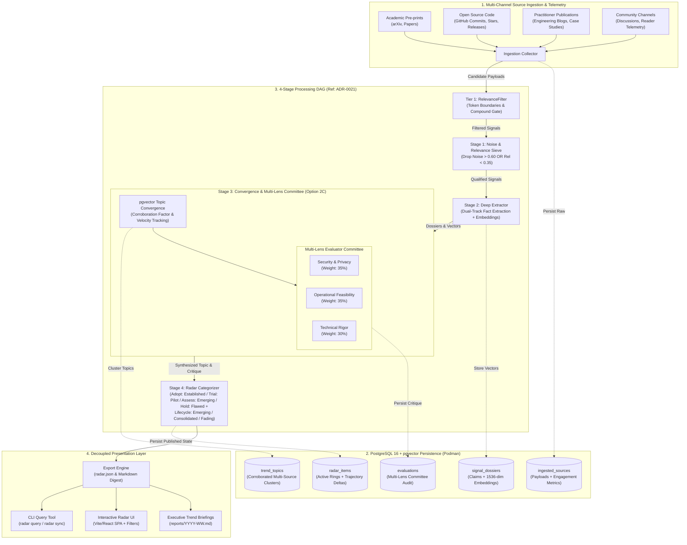
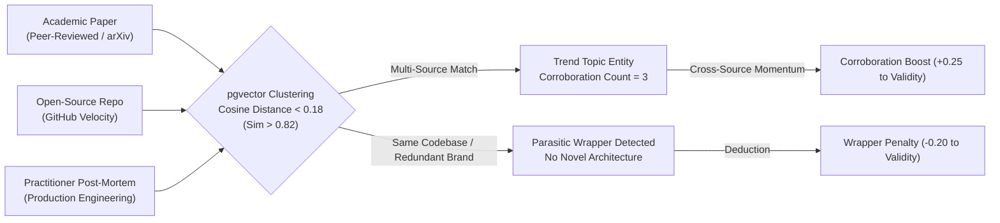

# System Design & Architecture: Trend Horizon Radar

## 1. System Overview & Problem Statement

In times of rapid technological and market disruption, professionals, researchers, and engineering leaders are overwhelmed by promotional marketing, ephemeral wrapper tools, non-reproducible benchmarks, and noisy social echo chambers. 

The **Trend Horizon Radar** is a generic, autonomous trend intelligence platform designed to replace manual, ad-hoc discovery with deterministic signal extraction, adversarial skepticism, and automated viability evaluation. 

The platform separates the **Core Trend Engine** from domain-specific rules via pluggable **Domain Profiles**. The initial reference profile targets **Software Quality Engineering (QE) and SDLC Innovations**.

---

## 2. Core Architectural Pillars

1. **Domain-Agnostic Core Engine:** Modular ingestion, noise filtering, topic clustering, multi-lens committee evaluation, and visualization.
2. **Pluggable Domain Profiles:** Configurable taxonomies, heuristic filters, and evaluation committee lenses (e.g., Security, Operational Reliability, Technical Rigor).
3. **Multi-Source Corroboration & Topic Convergence:** Uses `pgvector` semantic distance to cluster related signals across independent channels (papers, repos, post-mortems). Independent cross-source convergence acts as a major positive signal of technological consensus.
4. **Audience Telemetry & Engagement Velocity:** Ingestion collectors capture engagement data (stars, citations, readers, viewers, discussions) and compute time-decayed velocity ($\Delta \text{metric}/\Delta t$) to differentiate real momentum from fading fads.
5. **Adversarial Multi-Lens Evaluation:** Evaluates candidate innovations across specialized lenses to produce an un-hyped viability assessment.

---

## 3. High-Level Architecture & Pipeline DAG

---

## 4. Multi-Source Corroboration & Topic Clustering

### 4.1 Corroboration Mechanics
When a signal is processed, the system queries historical dossiers in `pgvector`:
1. **Convergence Condition:** If an ingested signal shares semantic similarity $> 0.82$ with existing dossiers from **different source channels or distinct authors**, the items are linked to a shared `TrendTopic`.
2. **Corroboration Factor:**
   $$C_{\text{factor}} = \min\left(1.0, \frac{N_{\text{distinct\_sources}}}{4}\right)$$
   A positive bonus ($+0.10$ to $+0.30$) is awarded to Signal Validity based on independent source convergence.
3. **Wrapper Penalty:** If similarity $> 0.88$ with an existing tool/paper but the new submission introduces no new code, dataset, or empirical mechanism, a $-0.20$ wrapper deduction is applied.

---

## 5. Audience Engagement & Velocity Dynamics

To distinguish rising innovations from flash-in-the-pan hype:

1. **Normalized Telemetry Metrics:**
   - **Academic:** Citations, download rates.
   - **Open Source:** Stars, forks, contributor velocity, issue resolution ratio.
   - **Media & Articles:** Views, discussion comment volume, social upvotes.
2. **Engagement Velocity:**
   $$\text{Velocity} = \frac{\Delta \text{Engagement}}{\Delta t} \times \text{Source Authority}$$
3. **Lifecycle Trajectories:**
   - **Emerging:** High velocity, low cumulative volume, rapidly rising cross-source corroboration.
   - **Consolidated:** High cumulative volume, steady velocity, proven production track record.
   - **Fading:** Initial viral peak followed by rapid decline in velocity and zero follow-on implementations.

---

## 6. Evaluation Rubric & Multi-Lens Committee

### 6.1 Signal Validity Score ($S_v$)
Baseline starts at $0.50$:
- **Anti-Hype Deductions:**
  - $-0.30$: No reproducible benchmark, raw dataset, or source repository.
  - $-0.25$: Trivial synthetic vanity benchmark only.
  - $-0.20$: Superficial wrapper architecture.
  - $-0.15$: Sponsored promotional placement without practitioner review.
- **Engineering & Convergence Bonuses:**
  - $+0.30$: Peer-reviewed publication with reproducible artifacts.
  - $+0.25$: Independent multi-source corroboration ($N_{\text{sources}} \ge 3$).
  - $+0.20$: High open-source contributor velocity.
  - $+0.20$: Production post-mortem from a recognized engineering organization.

Composite **Hype Score**: $H = 1.0 - S_v$.

### 6.2 Multi-Lens Viability Score ($E_v$)
The **Adversarial Committee (Option 2C)** evaluates qualified signals across three lenses:
1. **Security & Privacy Lens (Weight: 35%):** Data egress boundaries, VPC/on-prem compatibility, secret scrubbing.
2. **Operational Feasibility Lens (Weight: 35%):** Deterministic reproducibility, runner compute footprint, integration friction.
3. **Technical Rigor Lens (Weight: 30%):** True defect/problem resolution vs vanity benchmarks, contract compliance.

$$\text{Composite Viability: } E_v = 0.35 \cdot S_{\text{sec}} + 0.35 \cdot S_{\text{ops}} + 0.30 \cdot S_{\text{tech}}$$

---

## 7. Reference Domain Profile: Software Quality Engineering (QE)

The reference profile categorizes SDLC Quality Engineering into 6 pillars:

| Pillar | Domain Scope |
| :--- | :--- |
| **1. Spec & Model** | Requirements-to-test generation, formal verification, model-based testing, property generation. |
| **2. Test Synth** | Automated E2E, integration, unit test generation, synthetic data synthesis, TDM, API mocking. |
| **3. Execution & Optimization** | Mutation testing, predictive test selection (PTS), flaky test isolation, parallel scheduling. |
| **4. Triage & Fix** | Root Cause Analysis (RCA), self-healing test scripts, automated PR repair patches. |
| **5. Agent Systems** | Autonomous browser-use testing agents, CLI coding agents for QE, multi-agent test workflows. |
| **6. Governance & Evals** | LLM-as-a-judge test suites, safety, red-teaming, prompt regression, determinism verification. |

---

## 8. Presentation & Delivery Architecture

1. **Versioned Dataset (`radar.json`):** Self-contained JSON export containing active items, corroborating source counts, velocity metrics, lifecycle stages, and 2D UMAP projection coordinates.
2. **Interactive Web Application (`web/`):**
   - Quad-Quadrant / Multi-Ring Radar with zoomable blips.
   - Matrix Table with instant search, sorting, and deep dossier inspection.
   - Multi-Criteria Sidebar Filters (Rings, Categories, Evidence Tiers, Viability / Hype sliders, Lifecycle stage).
   - Topic Cluster View showing interconnected corroborating sources.
3. **Bi-Weekly Intelligence Digest:** Automated Markdown report summarizing new entrants, ring migrations, and rising trend topics.
